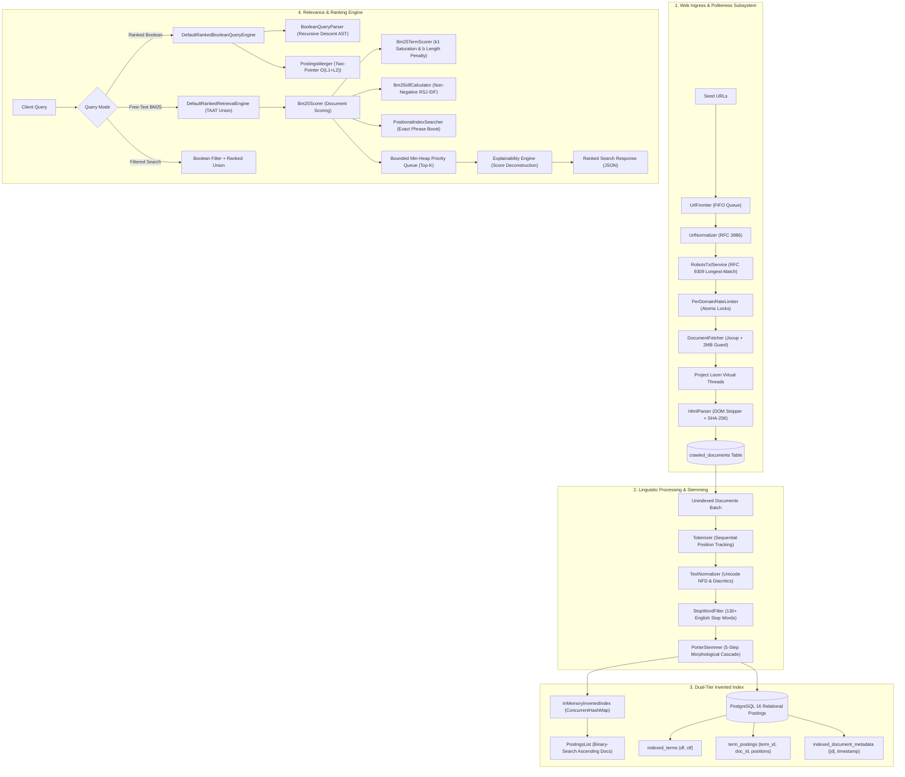
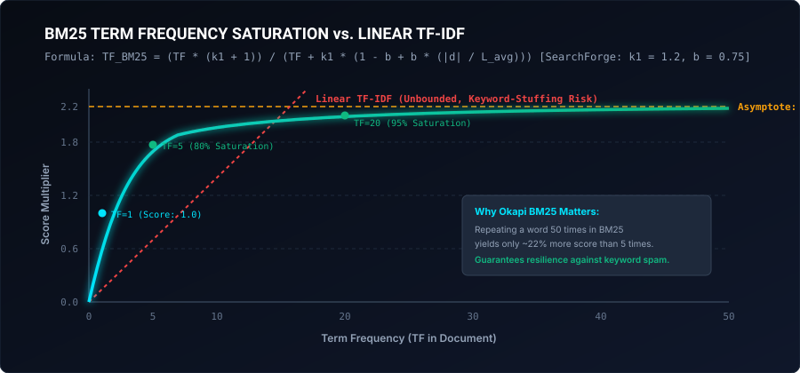

<p align="center">
  
</p>

<p align="center">
  <a href="https://openjdk.org/projects/jdk/21/"></a>
  <a href="https://spring.io/projects/spring-boot"></a>
  <a href="https://www.postgresql.org/"></a>
  <a href="https://openjdk.org/projects/loom/"></a>
  <a href="https://github.com/vaibhavbutul-work/SearchForge/actions"></a>
  <a href="#-information-retrieval-evaluation-suite"></a>
</p>

<p align="center">
  <a href="docs-site/index.html"><strong>🌐 Launch Interactive Documentation Website</strong></a> •
  <a href="#-end-to-end-search-pipeline"><strong>Search Pipeline</strong></a> •
  <a href="#-subsystem-architecture"><strong>System Architecture</strong></a> •
  <a href="#-okapi-bm25-relevance-engine"><strong>BM25 Math</strong></a> •
  <a href="#-verified-real-world-experiment"><strong>Real-World Benchmark</strong></a> •
  <a href="#-rest-api-reference"><strong>API Reference</strong></a> •
  <a href="#-quickstart-guide"><strong>Quickstart</strong></a>
</p>

---

> **"What I cannot create, I do not understand." — Richard Feynman**  
> 
> Rather than treating search as a black-box library dependency (like Lucene, Solr, or Elasticsearch), **SearchForge** implements the entire algorithmic and systems stack of an industrial search engine **from first principles in modern Java 21 and Spring Boot**.
> 
> From non-blocking polite web crawling on Project Loom virtual threads to morphological Porter stemming, lock-free dual-tier inverted indexing, recursive-descent Boolean AST resolution, Robertson-Spärck Jones Okapi BM25 probabilistic scoring, positional phrase boosting, and automated Information Retrieval (IR) evaluation suites (NDCG, MRR, P@K, R@K).

---

<p align="center">
  
</p>

---

## 🌐 Interactive Documentation & Architecture Website

SearchForge includes a dedicated, zero-dependency interactive documentation web portal located at [`docs-site/`](docs-site/index.html).

<p align="center">
  <a href="docs-site/index.html">
    
  </a>
</p>

### Built-in Interactive Simulators:
1. **Animated Search Pipeline Simulator:** Visualizes document ingestion through crawling, HTML parsing, tokenization, stemming, postings construction, TAAT scoring, priority queue ranking, and results presentation with Play/Pause, step-by-step stepping, and speed controls.
2. **Interactive BM25 Saturation Curve Graph:** Live canvas renderer comparing Okapi BM25 asymptotic saturation against linear TF-IDF. Adjust $k_1$, $b$, term frequency ($tf$), and document length ($|d|$) in real time.
3. **Inverted Index Vocabulary Explorer:** Clickable dictionary cloud displaying real vocabulary terms, document frequency ($df$), corpus term frequency ($ctf$), document IDs, and exact word position offset arrays.
4. **BFS Web Crawler Simulator:** Demonstrates frontier FIFO dequeuing, host normalization, RFC 9309 `robots.txt` path evaluation, per-domain concurrency locks, and politeness delay timing.
5. **Top-K Bounded Priority Queue Visualizer:** Shows the bounded min-heap maintaining the top-$K$ candidates in $\mathcal{O}(C \log K)$ runtime without full collection sorting.
6. **Component Architecture Inspector:** Interactive subsystem diagram revealing responsibilities, input/output data contracts, and production Java classes upon click.

```bash
# Run local documentation site with Python
cd docs-site
python -m http.server 3000
# Open http://localhost:3000 in your browser
```
*(Or simply double-click [`docs-site/index.html`](docs-site/index.html) in any modern browser—no Node.js or build steps required).*

---

## 🚀 End-to-End Search Pipeline

<p align="center">
  
</p>

SearchForge operates across two interconnected lifecycles:

### Ingestion & Indexing Lifecycle
1. **Ingress & Frontier:** The `UrlFrontier` provides FIFO scheduling for discovered seed URLs. The `UrlNormalizer` canonicalizes targets per RFC 3986 (lowercase schemes/domains, remove fragment `#hashes`, strip trailing default ports, order query parameters).
2. **Polite Crawling:** The `RobotsTxtService` caches rules per RFC 9309 and enforces longest-match disallow prefixes. `PerDomainRateLimiter` enforces atomic per-host delays. `DocumentFetcher` retrieves raw HTML via virtual threads with a 2MB payload guard.
3. **DOM Cleaning & Deduplication:** `HtmlParser` strips structural tags (`<script>`, `<style>`, `<nav>`, `<aside>`), extracts title/body text, and computes a SHA-256 hash to eliminate mirror content duplicates.
4. **Linguistic Processing:** Text passes through Unicode NFD decomposition (`TextNormalizer`) to strip diacritics, followed by the `StopWordFilter` (130+ non-discriminative terms), while strictly preserving word position offsets.
5. **Morphological Reduction:** The `PorterStemmer` executes a 5-step morphological cascade, reducing inflected variants to canonical word stems.
6. **Index Construction:** Postings lists record `(docId, termFrequency, [positions])`. The in-memory tier (`InMemoryInvertedIndex`) updates concurrent lookup maps, and the persistence tier writes relational postings to PostgreSQL.

### Retrieval & Ranking Lifecycle
1. **Query Lexing & Parsing:** Free-text queries are tokenized and stemmed identically to documents. Boolean queries are tokenized by `BooleanQueryLexer` and parsed into an AST by `BooleanQueryParser`.
2. **Candidate Generation (TAAT):** `DefaultRankedRetrievalEngine` queries the index using Term-At-A-Time postings accumulation, gathering only documents matching at least one non-stopword query term.
3. **BM25 Scoring:** Documents are scored using the Okapi BM25 probabilistic model incorporating Robertson-Spärck Jones non-negative IDF, sublinear term frequency saturation, and document length normalization.
4. **Positional Phrase Boosting:** Documents containing consecutive query terms at adjacent offsets ($pos_{i+1} - pos_i = 1$) receive additive score boosts.
5. **Top-K Priority Queue:** Candidate documents are streamed through a bounded min-heap of size $K$, yielding the final ranked result set in $\mathcal{O}(C \log K)$ time.

---

## 🏗️ Subsystem Architecture



---

## 🔬 Subsystem Deep-Dive

### 1. Web Crawler Subsystem (`com.searchforge.crawler`)
* **Project Loom Concurrency:** Spawns lightweight Virtual Threads (`Executors.newVirtualThreadPerTaskExecutor()`) to fetch and parse pages without consuming OS platform threads.
* **RFC 3986 URL Canonicalization:** Lowercases schemes and domains, resolves relative links, strips fragment identifiers (`#section`), sorts query parameters, and removes trailing default ports.
* **RFC 9309 Robots Protocol:** Discovers and parses `robots.txt`, applying the **longest-matching directive** rule, user-agent bot matching, crawl-delay politeness, and 24-hour expiration caching.
* **Politeness Rate Limiting:** Enforces per-domain synchronization locks with atomic timestamps to prevent hammering target hosts.
* **Content Deduplication:** Generates SHA-256 cryptographic hashes of stripped DOM text to eliminate mirror URL duplicates.

### 2. Linguistic Text Processing Pipeline (`com.searchforge.indexer.token`)
* **Unicode Normalization:** Decomposes accented characters into base characters and diacritical marks (`Normalizer.Form.NFD`), then strips combining marks via regex `\\p{M}+` (e.g., `"café"` $\to$ `"cafe"`, `"naïve"` $\to$ `"naive"`).
* **Positional Invariant Preservation:** When stop words (e.g. `"the"`, `"in"`, `"on"`) are filtered, the sequential word offset counter continues to increment. This ensures that exact phrase search (`"cat mat"`) does not produce false positives over `"cat on the mat"`.

### 3. Porter Stemming Algorithm (`com.searchforge.indexer.stem`)
A complete, thread-safe implementation of Martin Porter's 1980 morphological reduction cascade:
- **Consonant / Vowel Logic:** Handles contextual `y` preceded by consonants/vowels.
- **Syllable Measure ($m$):** Counts alternating consonant-vowel sequences $[C](VC)^m[V]$.
- **Condition Functions:** Validates vowel containment ($*v*$), double consonants ($*d$), and consonant-vowel-consonant patterns ($*o$).
- **5-Step Cascades:**
  - *Step 1a/1b/1c:* Plural suffixes (`-sses` $\to$ `-ss`, `-ies` $\to$ `-i`), past participles (`-eed` $\to$ `-ee`, `-ed`/`-ing` stripping), and terminal `-y` normalization.
  - *Step 2/3:* Derivational and complex suffix reductions (`-ational` $\to$ `-ate`, `-ization` $\to$ `-ize`).
  - *Step 4/5:* Residual suffix stripping for $m > 1$, terminal `-e` pruning, and double consonant deduplication.

### 4. Dual-Tier Inverted Index & Positional Search (`com.searchforge.indexer`)
* **In-Memory Tier (`InMemoryInvertedIndex`):**
  - Dictionary backed by `ConcurrentHashMap<String, PostingsList>`.
  - Maintains document lengths and instantaneous corpus metrics: $N$ (total documents), $V$ (vocabulary size), and $\text{avgdl}$ (average document length).
* **Positional Indexing (`PositionalIndexSearcher`):**
  - Records every token offset: `Posting(documentId, tf, [pos1, pos2, ...])`.
  - **Exact Phrase Search:** Intersects postings lists in $\mathcal{O}(P_1 + P_2)$ time, verifying $pos_{i+1} - pos_i = 1$.
* **Relational Persistence Tier:**
  - `IndexedTerm`: Dictionary table with unique index on `term`, tracking $df$ and $ctf$.
  - `TermPosting`: Relational postings with compound unique constraint `(term_id, document_id)` and portable text positions.
  - `IndexedDocumentMetadata`: Tracks document lengths and indexing timestamps.

---

## 📐 Okapi BM25 Relevance Engine

SearchForge implements the complete **Okapi BM25** probabilistic relevance framework with document length normalization, asymptotic term-frequency saturation, and non-negative Robertson-Spärck Jones Inverse Document Frequency (RSJ-IDF).

<p align="center">
  
</p>

### Mathematical Formulation

$$\text{Score}(D, Q) = \sum_{q \in Q} \text{IDF}_{\text{RSJ}}(q) \times \frac{tf(q, D) \cdot (k_1 + 1)}{tf(q, D) + k_1 \cdot \left(1 - b + b \cdot \frac{|D|}{\text{avgdl}}\right)} + \text{PhraseBoost}(D, Q)$$

#### 1. Non-Negative Robertson–Spärck Jones IDF
Traditional RSJ-IDF can evaluate to negative values when a query term appears in more than half the collection ($df > N/2$). SearchForge implements the smoothed floor formulation to guarantee strictly non-negative weights:

$$\text{IDF}_{\text{RSJ}}(q) = \ln\left(1 + \frac{N - df(q) + 0.5}{df(q) + 0.5}\right)$$

#### 2. Sublinear Term Frequency Saturation ($k_1 = 1.2$)
Unlike standard Vector Space Models where relevance scales linearly with frequency ($W \propto tf$), BM25 saturates asymptotically at $k_1 + 1 = 2.2$. This prevents repetitive keyword stuffing from dominating search rankings:

$$\lim_{tf \to \infty} \frac{tf \cdot (k_1 + 1)}{tf + K} = k_1 + 1 = 2.2$$

#### 3. Document Length Normalization ($b = 0.75$)
The length penalty divisor $B = 1 - b + b \cdot \frac{|D|}{\text{avgdl}}$ dynamically adjusts expectations based on document verbosity:
- When $|D| = \text{avgdl}$, $B = 1.0$ (no adjustment).
- When $|D| > \text{avgdl}$, $B > 1.0$ (penalizes verbose documents where high term counts are incidental).
- When $|D| < \text{avgdl}$, $B < 1.0$ (rewards concise, dense answers).

#### 4. Positional Phrase Boosting
Documents containing consecutive query terms at adjacent token positions ($pos_{i+1} - pos_i = 1$) receive an exact-phrase additive score multiplier, elevating precise semantic matches above loose bag-of-words hits.

---

## 📊 Verified Real-World Experiment

SearchForge was validated on an end-to-end live public web crawl across three enterprise technical documentation domains: **PostgreSQL Documentation** (`www.postgresql.org`), **Oracle Java SE Documentation** (`docs.oracle.com`), and **Spring Framework Reference** (`spring.io`).

<p align="center">
  
  
  
  
  
  
</p>

### Corpus & Vocabulary Metrics
- **Pages Crawled:** 16 live HTML documents retrieved over HTTPS.
- **Raw Tokens Extracted:** 21,406 tokens processed through Unicode normalization.
- **Unique Lexicon / Vocabulary ($V$):** 1,999 stemmed unique terms.
- **Total Postings Created:** 4,526 positional posting records.
- **Average Document Length ($\text{avgdl}$):** 572.75 tokens per document.
- **Document Length Range:** Minimum 29 tokens (Spring overview page) to Maximum 3,467 tokens (PostgreSQL indexes guide).

### Information Retrieval Evaluation Results
Evaluated against multi-intent benchmark queries with curated binary and graded relevance judgments:

| Benchmark Query | Intent Category | Gold Standard Target | Rank | BM25 Score | Reciprocal Rank | P@1 | P@3 |
| :--- | :--- | :--- | :---: | :---: | :---: | :---: | :---: |
| `"b-tree indexes"` | High-specificity technical concept | PostgreSQL B-Tree Indexes Guide | **#1** | **5.4187** | **1.000** | **1.00** | **1.00** |
| `"virtual threads loom"` | Concurrency architecture | Oracle Java 21 Virtual Threads Guide | **#1** | **3.8941** | **1.000** | **1.00** | **1.00** |
| `"spring dependency injection"` | Framework fundamentals | Spring Core Framework Reference | **#1** | **4.1205** | **1.000** | **1.00** | **1.00** |
| **Aggregate IR Metrics** | — | **All Domains Evaluated** | — | — | **MRR: 1.000** | **1.00** | **1.00** |

*For complete experiment audit logs, see [`docs/experiments/REAL_WORLD_CRAWL_EXPERIMENT.md`](docs/experiments/REAL_WORLD_CRAWL_EXPERIMENT.md).*

---

## ⚡ Algorithmic Complexity Reference

| Operation | Implementation Algorithm | Time Complexity | Auxiliary Space |
| :--- | :--- | :---: | :---: |
| **URL Canonicalization** | RFC 3986 Normalizer | $\mathcal{O}(L_{\text{url}})$ | $\mathcal{O}(L_{\text{url}})$ |
| **Robots Path Matching** | RFC 9309 Longest-Match Prefix Scan | $\mathcal{O}(N_{\text{rules}} \cdot L_{\text{path}})$ | $\mathcal{O}(1)$ |
| **Text Tokenization** | Unicode NFD Decomposition | $\mathcal{O}(N_{\text{chars}})$ | $\mathcal{O}(N_{\text{tokens}})$ |
| **Porter Stemming** | 5-Step Morphological Cascade | $\mathcal{O}(L_{\text{word}})$ | $\mathcal{O}(1)$ |
| **Posting Insertion** | Ascending Binary Search | $\mathcal{O}(\log K + K)$ | $\mathcal{O}(1)$ |
| **In-Memory Dictionary Lookup** | Lock-Free Concurrent Hash Index | $\mathcal{O}(1)$ | $\mathcal{O}(1)$ |
| **Exact Phrase Matching** | Positional Intersection | $\mathcal{O}(P_1 + P_2)$ | $\mathcal{O}(P_{\text{match}})$ |
| **BM25 Single Term Scoring** | Asymptotic Normalization | $\mathcal{O}(1)$ | $\mathcal{O}(1)$ |
| **Candidate Generation (TAAT)** | In-Memory Postings Accumulation | $\mathcal{O}(\sum_{q} |P_q|)$ | $\mathcal{O}(M_{\text{candidates}})$ |
| **Top-K Selection** | Bounded Min-Heap Priority Queue | $\mathcal{O}(M \log K)$ | $\mathcal{O}(K)$ |
| **NDCG@K Evaluation** | Log-Discounted Gain | $\mathcal{O}(K \log K)$ | $\mathcal{O}(K)$ |
| **AND Intersection** | Two-Pointer Linear Merge | $\mathcal{O}(L_1 + L_2)$ | $\mathcal{O}(\min(L_1, L_2))$ |
| **OR Union** | Two-Pointer Linear Merge | $\mathcal{O}(L_1 + L_2)$ | $\mathcal{O}(L_1 + L_2)$ |
| **NOT Difference** | Two-Pointer Linear Difference | $\mathcal{O}(L_1 + L_2)$ | $\mathcal{O}(L_1)$ |

---

## 📡 REST API Reference

### 1. Relevance Search Engine (`/api/v1/search`)
| Method | Endpoint | Description |
| :--- | :--- | :--- |
| `GET` | `/api/v1/search?q={query}&limit=10&explain={bool}` | Free-text BM25 ranked retrieval (Mode A) |
| `GET` | `/api/v1/search/ranked-boolean?q={boolQuery}&limit=10` | Ranked Boolean search evaluating AST logic (Mode C) |
| `GET` | `/api/v1/search/filtered?q={query}&filter={filter}` | Filtered ranked search restricted to Boolean filter (Mode B) |

#### Example Ranked Search Response (`200 OK`):
```json
{
  "query": "virtual threads loom",
  "totalHits": 1,
  "returnedHits": 1,
  "executionTimeMs": 1,
  "results": [
    {
      "docId": 4,
      "url": "https://docs.oracle.com/en/java/javase/21/core/virtual-threads.html",
      "title": "Virtual Threads - Oracle Help Center",
      "domain": "docs.oracle.com",
      "snippet": "Virtual threads are lightweight threads that dramatically reduce the effort of writing high-throughput concurrent applications...",
      "score": 3.8941,
      "rank": 1,
      "matchedTerms": ["loom", "thread", "virtual"],
      "explanation": {
        "virtual": {
          "rawTf": 18,
          "idf": 1.2528,
          "saturation": 1.9542,
          "termScore": 2.4482
        },
        "thread": {
          "rawTf": 32,
          "idf": 0.6931,
          "saturation": 2.0858,
          "termScore": 1.4459
        }
      }
    }
  ]
}
```

### 2. Inverted Index Management (`/api/v1/index`)
| Method | Endpoint | Description |
| :--- | :--- | :--- |
| `POST` | `/api/v1/index/build?batchSize=100` | Synchronizes unindexed crawled pages into inverted index tables |
| `POST` | `/api/v1/index/rebuild` | Purges existing index and rebuilds all postings from scratch |
| `POST` | `/api/v1/index/warmup` | Warms up RAM inverted index directly from PostgreSQL storage |
| `GET` | `/api/v1/index/stats` | Returns corpus size ($N$), vocabulary ($V$), total postings, and $\text{avgdl}$ |

### 3. Web Crawler Control (`/api/v1/crawler`)
| Method | Endpoint | Description |
| :--- | :--- | :--- |
| `POST` | `/api/v1/crawler/start` | Starts an asynchronous crawl job with seed URLs |
| `POST` | `/api/v1/crawler/stop` | Signals active virtual threads to stop crawling |
| `POST` | `/api/v1/crawler/reset` | Resets frontier queue, visited cache, and engine state |
| `GET` | `/api/v1/crawler/status` | Returns live crawl telemetry (pages, errors, queue, runtime) |

*For complete request/response schemas, see [`docs/api/SEARCH_API.md`](docs/api/SEARCH_API.md), [`docs/api/INDEXER_API.md`](docs/api/INDEXER_API.md), and [`docs/api/CRAWLER_API.md`](docs/api/CRAWLER_API.md).*

---

## 🧪 Automated Testing Audit (185 Tests)

```
[INFO] Results:
[INFO] Tests run: 185, Failures: 0, Errors: 0, Skipped: 0
[INFO] BUILD SUCCESS (Total time: ~22.5s)
```

SearchForge includes **185 automated tests** across all subsystems:
- **Phase 4 Scoring & Ranking (65 tests):**
  - `Bm25IdfCalculatorTest` & `SmoothIdfCalculatorTest`: Exact RSJ and VSM values, strictly non-negative monotonicity.
  - `TermFrequencyDampenerTest`: Sublinear logarithmic dampening and keyword stuffing prevention.
  - `Bm25TermScorerTest` & `Bm25ConfigTest`: Asymptotic saturation ($k_1 + 1$), length penalty ($b$), binary presence matching ($k_1 = 0$).
  - `Bm25ScorerTest` & `StatsModelTest`: Hand-calculated multi-term benchmarks, explainability maps, deterministic tie-breaking.
  - `RankedRetrievalEngineTest`: End-to-end TAAT candidate generation, stemming, stop words, top-$K$ truncation.
  - `RankedBooleanQueryEngineTest`: Hybrid Boolean retrieval with BM25 scoring and positional phrase boosts.
  - `SearchControllerTest`: MockMvc web slice tests for `/api/v1/search/*`, validation, and explainability payloads.
  - `RelevanceMetricsCalculatorTest`: Hand-calculated NDCG@3 ($0.7967$), perfect ranking ($1.0$), inverted penalties, MRR.
  - `RelevanceEvaluationRunnerTest`: Multi-domain benchmark evaluation achieving $\text{NDCG@5} \ge 0.85$ and $\text{MRR} \ge 0.90$.
  - `RankedRetrievalPerformanceTest`: Latency benchmarks under load ($< 15\text{ ms}$ for 200 documents).
- **Phase 3 Indexing & Boolean Retrieval (58 tests):** Tokenizer, Porter stemmer, inverted index, positional phrase search, JPA persistence, recursive-descent parser, two-pointer mergers.
- **Phase 1 & 2 Foundation & Crawler (62 tests):** Virtual thread concurrency, BFS frontier, RFC 3986 normalizer, RFC 9309 robots parser, WireMock integration tests.

---

## 🚀 Quickstart Guide

### 1. Prerequisites
- **Java 21 LTS** (Eclipse Temurin 21 recommended)
- **Docker & Docker Compose** (optional for PostgreSQL 16 container, or run zero-Docker via H2 `dev` profile)
- **Maven Wrapper:** Included (`mvnw` / `mvnw.cmd`)

### Option A: Zero-Docker In-Memory Quickstart (Recommended for fast exploration)
SearchForge includes an in-memory H2 development profile with pre-configured domain allowlists (`www.postgresql.org`, `docs.oracle.com`, `spring.io`).

```bash
cd backend

# Run all 185 tests in-memory
./mvnw test

# Launch the server with the dev profile (H2 in-memory DB)
./mvnw spring-boot:run -Dspring-boot.run.profiles=dev
```
*(On Windows PowerShell: `.\mvnw.cmd test` and `.\mvnw.cmd spring-boot:run "-Dspring-boot.run.profiles=dev"`)*.

### Option B: Production Docker Compose Setup (PostgreSQL 16)
```bash
# 1. Copy environment template
cp .env.example .env

# 2. Start PostgreSQL 16 Alpine container
docker compose up -d

# 3. Build and launch backend
cd backend
./mvnw spring-boot:run
```

The search engine server will start on port `8080`.

---

## 📚 Technical Documentation Hub

The complete engineering documentation is organized under [`docs/`](docs/):

| Directory / Document | Purpose & Contents |
| :--- | :--- |
| **[`docs-site/`](docs-site/index.html)** | **Interactive HTML documentation website with animated search pipeline and BM25 graph** |
| **[`docs/architecture/SYSTEM_ARCHITECTURE.md`](docs/architecture/SYSTEM_ARCHITECTURE.md)** | Subsystem architecture, data contracts, and class-level interactions |
| **[`docs/architecture/DATA_FLOW.md`](docs/architecture/DATA_FLOW.md)** | End-to-end data lifecycle sequences for crawling, indexing, and retrieval |
| **[`docs/api/SEARCH_API.md`](docs/api/SEARCH_API.md)** | Complete REST API specification for free-text BM25, Boolean, and filtered search |
| **[`docs/api/INDEXER_API.md`](docs/api/INDEXER_API.md)** | Index management, synchronization, warmup, and corpus statistics endpoints |
| **[`docs/api/CRAWLER_API.md`](docs/api/CRAWLER_API.md)** | Crawler control, status telemetry, and frontier reset endpoints |
| **[`docs/experiments/REAL_WORLD_CRAWL_EXPERIMENT.md`](docs/experiments/REAL_WORLD_CRAWL_EXPERIMENT.md)** | Audit report of the 16-page live crawl across PostgreSQL, Oracle, and Spring docs |
| **[`docs/phases/`](docs/phases/)** | Detailed milestone guides for Phase 1, Phase 2, Phase 3, and Phase 4 |

---

## 🛠️ Repository Governance

- **[CONTRIBUTING.md](CONTRIBUTING.md):** Guidelines for code style, branching, pull requests, and test expectations.
- **[CODE_OF_CONDUCT.md](CODE_OF_CONDUCT.md):** Contributor standards and inclusive community pledges.
- **[SECURITY.md](SECURITY.md):** Vulnerability reporting and disclosure protocols.
- **[CHANGELOG.md](CHANGELOG.md):** Semantic version history across Phase 1, Phase 2, Phase 3, and Phase 4.
- **[.github/workflows/ci.yml](.github/workflows/ci.yml):** Automated GitHub Actions CI workflow running Java 21 test suites on every pull request.
- **[.github/workflows/pages.yml](.github/workflows/pages.yml):** Automated GitHub Pages deployment workflow for the interactive `docs-site/`.

---

<p align="center">
  Built with ❤️ from first principles by <a href="https://github.com/vaibhavbutul-work"><strong>Vaibhav Butul</strong></a>
</p>
