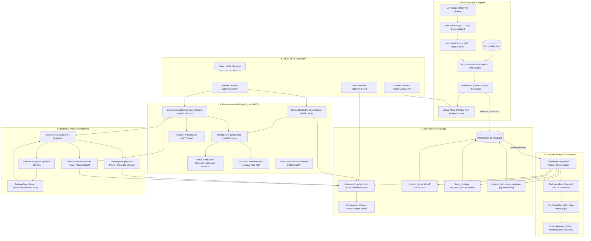

# SearchForge 🔍
### *Industrial-Grade Custom Search Engine Built From First Principles*

[](https://openjdk.org/projects/jdk/21/)
[](https://spring.io/projects/spring-boot)
[](https://www.postgresql.org/)
[](https://openjdk.org/projects/loom/)
[-brightgreen?style=for-the-badge&logo=checkmarx&logoColor=white)](https://github.com/vaibhavbutul-work/SearchForge)
[](https://github.com/vaibhavbutul-work/SearchForge)

> **"What I cannot create, I do not understand." — Richard Feynman**  
> Rather than relying on black-box search frameworks like Apache Lucene or Elasticsearch, **SearchForge** implements every fundamental algorithm and data structure of an enterprise search engine from scratch: multi-worker polite web crawling, linguistic text processing, morphological stemming, thread-safe inverted indexing, positional exact phrase search, recursive-descent Boolean query parsing, **BM25 probabilistic relevance ranking**, **positional phrase boosting**, and **automated Information Retrieval (IR) evaluation suites (NDCG, MRR, P@K, R@K)**.

---

## 🌟 Why SearchForge Stands Out (Interviewer Highlights)

| Engineering Challenge | How SearchForge Solves It From First Principles |
| :--- | :--- |
| **High-Throughput Crawling** | Powered by **Java 21 Project Loom Virtual Threads**; non-blocking worker pools fetch and parse web pages concurrently without OS thread starvation. |
| **RFC 9309 Politeness** | Custom `robots.txt` parser implementing **longest-match path evaluation**, per-domain thread-safe concurrency locks, crawl delays, and 24-hour cache invalidation. |
| **Linguistic Processing** | Full **Unicode NFD canonical decomposition**, diacritical mark stripping, English possessive stripping, 130+ stop-word filtering with **strict positional preservation**. |
| **Morphological Stemming** | Complete implementation of **Martin Porter’s 1980 5-step cascade** ($m$-measure, vowel conditions $*v*$, double consonants $*d$, $cvc$ checks $*o$) in a thread-safe, stateless architecture. |
| **Dual-Tier Inverted Index** | **RAM Tier:** `ConcurrentHashMap` dictionary with ascending binary-search `PostingsList` containers.<br>**Persistent Tier:** PostgreSQL 16 schema with compound unique constraints and portable positional encoding. |
| **Positional Phrase Search** | Exact phrase search evaluated via **linear positional intersection** ($O(P_1 + P_2)$) and sliding-window proximity searches ($|pos_1 - pos_2| \le k$). |
| **Boolean Query Engine** | **Recursive-descent AST parser** supporting operator precedence (`NOT` > `AND` > `OR`), nested parentheses, implicit `AND`, and **two-pointer linear merges** ($O(L_1 + L_2)$). |
| **BM25 Relevance Engine** | Implemented **Okapi BM25** with asymptotic term frequency saturation ($k_1 = 1.2$) and document length normalization ($b = 0.75$), using strictly non-negative Robertson–Spärck Jones IDF. |
| **Positional Phrase Boosting** | Two-tier precision ranking crediting exact consecutive phrase matches identified via positional index intersection directly to document scores. |
| **Zero-I/O In-Memory Scoring** | In-memory candidate evaluation with zero database calls during scoring loops, and single-batch SQL queries for top-$K$ metadata retrieval. |
| **IR Evaluation Suite** | Automated evaluation runner measuring **NDCG@K**, **Mean Reciprocal Rank (MRR)**, **Precision@K**, and **Recall@K** on multi-topic ground-truth benchmarks. |
| **Zero-Flake Test Suite** | **185 automated tests** passing in ~22 seconds; hermetic integration tests running against an in-memory H2 database without Docker or internet dependencies. |

---

## 🏗️ End-to-End System Architecture



---

## 🗺️ Project Roadmap & Phase Status

| Phase | Milestone Name | Status | Key Deliverables & Algorithms | Tests |
| :---: | :--- | :---: | :--- | :---: |
| **Phase 1** | **Foundation & Infrastructure** | **Completed** | Modular Spring Boot 4 setup, Docker Compose PostgreSQL 16 Alpine, HikariCP, Health REST API, hermetic context tests | **7** |
| **Phase 2** | **Web Crawler Subsystem** | **Completed** | Loom Virtual Threads, BFS FIFO frontier, RFC 3986 normalizer, RFC 9309 robots parser, Jsoup DOM stripper, SHA-256 deduplication, crawler REST API | **55** |
| **Phase 3** | **Inverted Index & Boolean Retrieval** | **Completed** | Unicode NFD normalizer, 130+ stop-word filter, 5-step Porter stemmer, positional inverted index, relational PostgreSQL schema, recursive-descent query parser, two-pointer linear merge, Boolean search REST API | **120** |
| **Phase 4** | **Scoring, Ranking & Relevance Engine** | **Completed** | Okapi BM25 probabilistic model ($k_1, b$), Robertson–Spärck Jones non-negative IDF, TAAT candidate generation, positional phrase boosting, ranked Boolean search, explainability engine, automated IR evaluation (NDCG@K, MRR, P@K, R@K) | **185** |
| **Phase 5** | **Query Engine & Search Experience** | **Upcoming** | Query suggestion, spelling correction (Levenshtein edit distance / SymSpell), prefix trie autocomplete, dynamic snippet highlighting | *Pending* |
| **Phase 6** | **Web Dashboard & Deployment** | **Upcoming** | Modern React search dashboard, live query telemetry, latency percentiles (p50/p95/p99), containerized production deployment | *Pending* |

---

## 🔬 Deep-Dive Subsystem Breakdown

### 1. Web Crawler Subsystem (`com.searchforge.crawler`)
* **Project Loom Concurrency:** Spawns lightweight Virtual Threads (`Executors.newVirtualThreadPerTaskExecutor()`) to fetch and parse pages without consuming OS threads.
* **RFC 3986 URL Canonicalization:** Lowercases schemes and domains, resolves relative links, strips fragment identifiers (`#section`), sorts query parameters, and removes trailing default ports.
* **RFC 9309 Robots Protocol:** Discovers and parses `robots.txt`, applying the **longest-matching directive** rule, user-agent bot matching, crawl-delay politeness, and 24-hour expiration caching.
* **Politeness Rate Limiting:** Enforces per-domain synchronization locks with atomic timestamps to prevent hammering target hosts.
* **Content Deduplication:** Generates SHA-256 cryptographic hashes of stripped DOM text to eliminate mirror URL duplicates.

### 2. Linguistic Text Processing Pipeline (`com.searchforge.indexer.token`)
* **Unicode Normalization:** Decomposes accented characters into base characters and diacritical marks (`Normalizer.Form.NFD`), then strips combining marks via regex `\\p{M}+` (e.g., `"café"` $\to$ `"cafe"`, `"naïve"` $\to$ `"naive"`).
* **Positional Invariant Preservation:** When stop words (e.g. `"the"`, `"in"`, `"on"`) are filtered, the sequential word offset counter continues to increment. This ensures that exact phrase search (`"cat mat"`) does not produce false positives over `"cat on the mat"`.

### 3. Porter Stemming Algorithm (`com.searchforge.indexer.stem`)
A complete, thread-safe implementation of Martin Porter's 1980 morphological reduction cascade:
- **Consonant / Vowel Logic:** Handles contextual `$y$` preceded by consonants/vowels.
- **Syllable Measure ($m$):** Counts alternating consonant-vowel sequences $[C](VC)^m[V]$.
- **Condition Functions:** Validates vowel containment ($*v*$), double consonants ($*d$), and consonant-vowel-consonant patterns ($*o$).
- **5-Step Cascades:**
  - *Step 1a/1b/1c:* Plural suffixes, past participles, and terminal `-y` normalization.
  - *Step 2/3:* Derivational and complex suffix reductions (`-ational` $\to$ `-ate`, `-ization` $\to$ `-ize`).
  - *Step 4/5:* Residual suffix stripping for $m > 1$, terminal `-e` pruning, and double consonant deduplication.

### 4. Dual-Tier Inverted Index & Positional Search (`com.searchforge.indexer`)
* **In-Memory Tier (`InMemoryInvertedIndex`):**
  - Dictionary backed by `ConcurrentHashMap<String, PostingsList>`.
  - Maintains document lengths and instantaneous corpus metrics: $N$ (total documents), $V$ (vocabulary size), and $\text{avgdl}$ (average document length).
* **Positional Indexing (`PositionalIndexSearcher`):**
  - Records every token offset: `Posting(documentId, tf, [pos1, pos2, ...])`.
  - **Exact Phrase Search:** Intersects postings lists in $O(P_1 + P_2)$ time, verifying $pos_{i+1} - pos_i = 1$.
* **Relational Persistence Tier:**
  - `IndexedTerm`: Dictionary table with unique index on `term`, tracking $df$ and $ctf$.
  - `TermPosting`: Relational postings with compound unique constraint `(term_id, document_id)` and portable text positions.
  - `IndexedDocumentMetadata`: Tracks document lengths and indexing timestamps.

### 5. Scoring, Ranking & Relevance Engine (`com.searchforge.ranking`)
* **Okapi BM25 Scoring:**
  $$\text{BM25}(D, Q) = \sum_{q \in Q} \text{IDF}(q) \times \frac{tf(q, D) \cdot (k_1 + 1)}{tf(q, D) + k_1 \cdot \left(1 - b + b \cdot \frac{|D|}{\text{avgdl}}\right)}$$
  - **Asymptotic Saturation:** Terms asymptotically approach a ceiling multiplier of $k_1 + 1 = 2.2$.
  - **Length Normalization ($b = 0.75$):** Penalizes verbose pages while rewarding concise, highly-targeted answers.
  - **Positive RSJ IDF:** Guaranteed strictly non-negative weights: $\ln\left(1 + \frac{N - df + 0.5}{df + 0.5}\right)$.
* **Positional Phrase Boosting:** Enhances precision by crediting documents containing exact consecutive phrase matches.
* **Zero-I/O In-Memory Invariant:** Candidate scoring operates 100% in memory with pre-calculated IDFs and pre-fetched stats; zero SQL queries are made during candidate ranking.
* **Information Retrieval Evaluation Suite:** Automated benchmark measuring **NDCG@K**, **MRR**, **Precision@K**, and **Recall@K** across multi-domain test corpora.

---

## ⚡ Algorithmic Complexity Reference

| Operation | Implementation Algorithm | Time Complexity | Auxiliary Space |
| :--- | :--- | :---: | :---: |
| **URL Canonicalization** | RFC 3986 Parser | $O(L_{\text{url}})$ | $O(L_{\text{url}})$ |
| **Robots Path Matching** | Longest Prefix Tree Scan | $O(N_{\text{rules}} \cdot L_{\text{path}})$ | $O(1)$ |
| **Text Tokenization** | Unicode NFD Decomposition | $O(N_{\text{chars}})$ | $O(N_{\text{tokens}})$ |
| **Porter Stemming** | 5-Step Morphological Cascade | $O(L_{\text{word}})$ | $O(1)$ |
| **Posting Insertion** | Ascending Binary Search | $O(\log K + K)$ | $O(1)$ |
| **In-Memory Dictionary Lookup** | Lock-Free Hash Index | $O(1)$ | $O(1)$ |
| **Exact Phrase Matching** | Positional Intersection | $O(P_1 + P_2)$ | $O(P_{\text{match}})$ |
| **BM25 Single Term Scoring** | Asymptotic Normalization | $O(1)$ | $O(1)$ |
| **Candidate Generation (TAAT)** | In-Memory Postings Accumulation | $O(\sum_{q} \|P_q\|)$ | $O(M_{\text{candidates}})$ |
| **Top-K Selection** | Bounded Min-Heap / Stream Sort | $O(M \log K)$ | $O(K)$ |
| **NDCG@K Evaluation** | Log-Discounted Gain | $O(K \log K)$ | $O(K)$ |
| **AND Intersection** | Two-Pointer Linear Merge | $O(L_1 + L_2)$ | $O(\min(L_1, L_2))$ |
| **OR Union** | Two-Pointer Linear Merge | $O(L_1 + L_2)$ | $O(L_1 + L_2)$ |
| **NOT Difference** | Two-Pointer Linear Difference | $O(L_1 + L_2)$ | $O(L_1)$ |

---

## 📡 REST API Reference

### 1. Relevance Search Engine (`/api/v1/search`)
| Method | Endpoint | Description |
| :--- | :--- | :--- |
| `GET` | `/api/v1/search?q={query}&limit=10&explain={bool}` | Free-text BM25 ranked retrieval (Mode A) |
| `GET` | `/api/v1/search/ranked-boolean?q={boolQuery}&limit=10` | Ranked Boolean search evaluating AST logic (Mode C) |
| `GET` | `/api/v1/search/filtered?q={query}&filter={filter}` | Filtered ranked search restricted to Boolean filter (Mode B) |

#### Example Ranked Search Response (`200 OK`):
```json
{
  "query": "java spring boot",
  "totalHits": 2,
  "returnedHits": 2,
  "executionTimeMs": 3,
  "results": [
    {
      "docId": 1,
      "url": "https://searchforge.dev/spring",
      "title": "Spring Boot Masterclass",
      "domain": "searchforge.dev",
      "snippet": "Comprehensive guide to building custom search engines in Spring Boot with inverted indices...",
      "score": 1.1964,
      "rank": 1,
      "matchedTerms": ["boot", "java", "spring"],
      "explanation": {
        "java": {
          "rawTf": 2,
          "idf": 0.47,
          "saturation": 1.2727,
          "termScore": 0.5982
        },
        "spring": {
          "rawTf": 2,
          "idf": 0.47,
          "saturation": 1.2727,
          "termScore": 0.5982
        }
      }
    }
  ]
}
```

### 2. Inverted Index Management (`/api/v1/index`)
| Method | Endpoint | Description |
| :--- | :--- | :--- |
| `POST` | `/api/v1/index/build?batchSize=100` | Synchronizes unindexed crawled pages into inverted index tables |
| `POST` | `/api/v1/index/rebuild` | Purges existing index and rebuilds all postings from scratch |
| `POST` | `/api/v1/index/warmup` | Warms up RAM inverted index directly from PostgreSQL storage |
| `GET` | `/api/v1/index/stats` | Returns corpus size ($N$), vocabulary ($V$), total postings, and $\text{avgdl}$ |

### 3. Web Crawler Control (`/api/v1/crawler`)
| Method | Endpoint | Description |
| :--- | :--- | :--- |
| `POST` | `/api/v1/crawler/start` | Starts an asynchronous crawl job with seed URLs |
| `POST` | `/api/v1/crawler/stop` | Signals active virtual threads to stop crawling |
| `POST` | `/api/v1/crawler/reset` | Resets frontier queue, visited cache, and engine state |
| `GET` | `/api/v1/crawler/status` | Returns live crawl telemetry (pages, errors, queue, runtime) |

---

## 🧪 Automated Testing Audit (185 Tests)

```
[INFO] Results:
[INFO] Tests run: 185, Failures: 0, Errors: 0, Skipped: 0
[INFO] BUILD SUCCESS (Total time: ~22.5s)
```

SearchForge includes **185 automated tests** covering unit, integration, and web slice layers:
- **Phase 4 Scoring & Ranking (65 tests):**
  - `Bm25IdfCalculatorTest` & `SmoothIdfCalculatorTest`: Exact RSJ and VSM values, strictly non-negative monotonicity.
  - `TermFrequencyDampenerTest`: Sublinear logarithmic dampening and keyword stuffing prevention.
  - `Bm25TermScorerTest` & `Bm25ConfigTest`: Asymptotic saturation ($k_1 + 1$), length penalty ($b$), binary presence matching ($k_1 = 0$).
  - `Bm25ScorerTest` & `StatsModelTest`: Hand-calculated multi-term benchmarks, explainability maps, deterministic tie-breaking.
  - `RankedRetrievalEngineTest`: End-to-end TAAT candidate generation, stemming, stop words, top-$K$ truncation.
  - `RankedBooleanQueryEngineTest`: Hybrid Boolean retrieval with BM25 scoring and positional phrase boosts.
  - `SearchControllerTest`: MockMvc web slice tests for `/api/v1/search/*`, validation, and explainability payloads.
  - `RelevanceMetricsCalculatorTest`: Hand-calculated NDCG@3 ($0.7967$), perfect ranking ($1.0$), inverted penalties, MRR.
  - `RelevanceEvaluationRunnerTest`: Multi-domain benchmark evaluation achieving $\text{NDCG@5} \ge 0.85$ and $\text{MRR} \ge 0.90$.
  - `RankedRetrievalPerformanceTest`: Latency benchmarks under load ($< 15\text{ ms}$ for 200 documents).
- **Phase 3 Indexing & Boolean Retrieval (58 tests):** Tokenizer, Porter stemmer, inverted index, positional phrase search, JPA persistence, recursive-descent parser, two-pointer mergers.
- **Phase 1 & 2 Foundation & Crawler (62 tests):** Virtual thread concurrency, BFS frontier, RFC 3986 normalizer, RFC 9309 robots parser, WireMock tests.

---

## 🚀 Quickstart & Setup Guide

### 1. Prerequisites
- **Java 21 LTS** (Eclipse Temurin 21 recommended)
- **Docker & Docker Compose** (for PostgreSQL 16 container)
- **Maven:** Bundled via Apache Maven Wrapper (`mvnw` / `mvnw.cmd`)

### 2. Configure Environment & Start Database
```powershell
# 1. Copy environment template
Copy-Item .env.example .env

# 2. Start PostgreSQL 16 Alpine container
docker compose up -d

# 3. Load environment variables into current PowerShell session (dot-source)
. .\scripts\load-env.ps1
```

### 3. Run Build & Verify All 185 Tests
```powershell
cd backend

# Execute all automated tests
.\mvnw.cmd test

# Launch the search engine server (runs on port 8080)
.\mvnw.cmd spring-boot:run
```
*(On Linux/macOS, use `./mvnw test` and `./mvnw spring-boot:run`)*.

---

## 📚 Technical Documentation Directory

- **[docs/PHASE_4_COMPLETE_GUIDE.md](file:///d:/projects/docs/PHASE_4_COMPLETE_GUIDE.md):** BM25 Derivations, Ranking Architecture, Phrase Boosting, IR Evaluation & Interview Prep.
- **[docs/PHASE_3_COMPLETE_GUIDE.md](file:///d:/projects/docs/PHASE_3_COMPLETE_GUIDE.md):** Inverted Index, Porter Stemmer, Positional Search & Boolean Retrieval.
- **[docs/PHASE_2_COMPLETE_GUIDE.md](file:///d:/projects/docs/PHASE_2_COMPLETE_GUIDE.md):** Web Crawler, RFC 9309 Politeness & Loom Concurrency.
- **[docs/PHASE_1_COMPLETE_GUIDE.md](file:///d:/projects/docs/PHASE_1_COMPLETE_GUIDE.md):** Foundation, Health Services, Docker & JDBC Architecture.
- **[docs/ARCHITECTURE.md](file:///d:/projects/docs/ARCHITECTURE.md):** Layered architecture and component interactions.
- **[docs/PROJECT_OVERVIEW.md](file:///d:/projects/docs/PROJECT_OVERVIEW.md):** Motivation, pipeline, and tech rationale.
