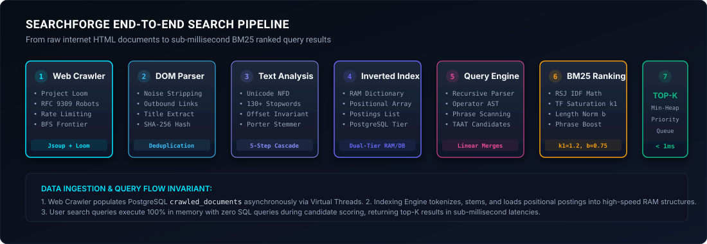
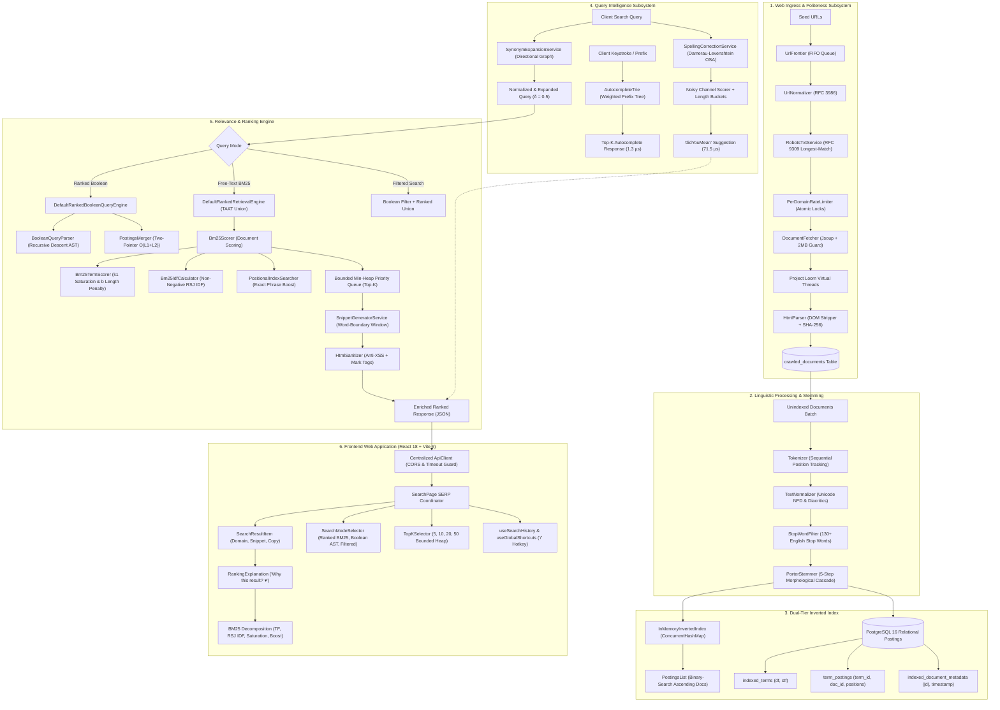

<p align="center">
  
</p>

<p align="center">
  <a href="https://openjdk.org/projects/jdk/21/"></a>
  <a href="https://spring.io/projects/spring-boot"></a>
  <a href="https://www.postgresql.org/"></a>
  <a href="https://openjdk.org/projects/loom/"></a>
  <a href="https://github.com/vaibhavbutul-work/SearchForge/actions"></a>
  <a href="#-information-retrieval-evaluation-suite"></a>
</p>

<p align="center">
  <a href="https://vaibhavbutul-work.github.io/SearchForge/"><strong>🌐 Launch Live Interactive Documentation Website</strong></a> •
  <a href="#-end-to-end-search-pipeline"><strong>Search Pipeline</strong></a> •
  <a href="#-security-engineering-api-hardening--production-security-phase-11"><strong>Security & Hardening</strong></a> •
  <a href="#-performance--scalability-engineering-phase-10"><strong>Performance Engineering</strong></a> •
  <a href="#-subsystem-architecture"><strong>System Architecture</strong></a> •
  <a href="#-index-lifecycle-data-consistency--recovery-phase-8"><strong>Index Lifecycle & Recovery</strong></a> •
  <a href="#-dense-semantic-retrieval--hybrid-search-phase-7"><strong>Hybrid & Semantic Search</strong></a> •
  <a href="#-okapi-bm25-relevance-engine"><strong>BM25 Math</strong></a> •
  <a href="#-query-intelligence--search-experience-phase-5"><strong>Query Intelligence</strong></a> •
  <a href="#-rest-api-reference"><strong>API Reference</strong></a> •
  <a href="#-quickstart-guide"><strong>Quickstart</strong></a>
</p>

---

> **"What I cannot create, I do not understand." — Richard Feynman**  
> 
> Rather than treating search as a black-box library dependency (like Lucene, Solr, or Elasticsearch), **SearchForge** implements the entire algorithmic and systems stack of an industrial search engine **from first principles in modern Java 21 and Spring Boot**.
> 
> From non-blocking polite web crawling on Project Loom virtual threads to morphological Porter stemming, lock-free dual-tier inverted indexing, recursive-descent Boolean AST resolution, Robertson-Spärck Jones Okapi BM25 probabilistic scoring, positional phrase boosting, real-time Weighted Trie prefix autocomplete, Damerau-Levenshtein spelling error correction with noisy channel scoring, dynamic sliding-window snippet extraction with anti-XSS highlighting, directional synonym query expansion, and automated Information Retrieval (IR) evaluation suites (NDCG, MRR, P@K, R@K).

---

<p align="center">
  
</p>

---

## 🌐 Interactive Documentation & Architecture Website

SearchForge includes a dedicated, zero-dependency interactive documentation web portal live at [vaibhavbutul-work.github.io/SearchForge](https://vaibhavbutul-work.github.io/SearchForge/).

<p align="center">
  <a href="https://vaibhavbutul-work.github.io/SearchForge/">
    
  </a>
</p>

### Built-in Interactive Simulators:
1. **Animated Search Pipeline Simulator:** Visualizes document ingestion through crawling, HTML parsing, tokenization, stemming, postings construction, TAAT scoring, priority queue ranking, and results presentation with Play/Pause, step-by-step stepping, and speed controls.
2. **Interactive BM25 Saturation Curve Graph:** Live canvas renderer comparing Okapi BM25 asymptotic saturation against linear TF-IDF. Adjust $k_1$, $b$, term frequency ($tf$), and document length ($|d|$) in real time.
3. **Inverted Index Vocabulary Explorer:** Clickable dictionary cloud displaying real vocabulary terms, document frequency ($df$), corpus term frequency ($ctf$), document IDs, and exact word position offset arrays.
4. **BFS Web Crawler Simulator:** Demonstrates frontier FIFO dequeuing, host normalization, RFC 9309 `robots.txt` path evaluation, per-domain concurrency locks, and politeness delay timing.
5. **Top-K Bounded Priority Queue Visualizer:** Shows the bounded min-heap maintaining the top-$K$ candidates in $\mathcal{O}(C \log K)$ runtime without full collection sorting.
6. **Component Architecture Inspector:** Interactive subsystem diagram revealing responsibilities, input/output data contracts, and production Java classes upon click.
7. **Query Intelligence & Suggestion Inspector:** Demonstrates real-time Trie prefix completion, Damerau-Levenshtein OSA edit-distance alignment, sliding-window snippet extraction with anti-XSS protection, and directional synonym expansion graphs.

```bash
# Run local documentation site with Python
cd docs-site
python -m http.server 3000
# Open http://localhost:3000 in your browser
```
*(Or simply double-click [`docs-site/index.html`](docs-site/index.html) in any modern browser—no Node.js or build steps required).*

---

## 🚀 End-to-End Search Pipeline

<p align="center">
  
</p>

SearchForge operates across two interconnected lifecycles:

### Ingestion & Indexing Lifecycle
1. **Ingress & Frontier:** The `UrlFrontier` provides FIFO scheduling for discovered seed URLs. The `UrlNormalizer` canonicalizes targets per RFC 3986 (lowercase schemes/domains, remove fragment `#hashes`, strip trailing default ports, order query parameters).
2. **Polite Crawling:** The `RobotsTxtService` caches rules per RFC 9309 and enforces longest-match disallow prefixes. `PerDomainRateLimiter` enforces atomic per-host delays. `DocumentFetcher` retrieves raw HTML via virtual threads with a 2MB payload guard.
3. **DOM Cleaning & Deduplication:** `HtmlParser` strips structural tags (`<script>`, `<style>`, `<nav>`, `<aside>`), extracts title/body text, and computes a SHA-256 hash to eliminate mirror content duplicates.
4. **Linguistic Processing:** Text passes through Unicode NFD decomposition (`TextNormalizer`) to strip diacritics, followed by the `StopWordFilter` (130+ non-discriminative terms), while strictly preserving word position offsets.
5. **Morphological Reduction:** The `PorterStemmer` executes a 5-step morphological cascade, reducing inflected variants to canonical word stems.
6. **Index Construction:** Postings lists record `(docId, termFrequency, [positions])`. The in-memory tier (`InMemoryInvertedIndex`) updates concurrent lookup maps, and the persistence tier writes relational postings to PostgreSQL.

### Retrieval & Ranking Lifecycle
1. **Query Pre-Processing & Suggestions:** Free-text queries pass through `SpellingCorrectionService` (Damerau-Levenshtein OSA distance + Noisy Channel model) to generate `didYouMean` suggestions. Keystroke prefixes trigger `TrieAutocompleteEngine` for real-time suggestions.
2. **Directional Synonym Expansion:** Queries are normalized and expanded by `SynonymExpansionService` using directional synonym graphs (`ONE_WAY` and `BIDIRECTIONAL`), while quoted phrases and Boolean operators (`AND`, `OR`, `NOT`) bypass expansion to protect AST semantics.
3. **Query Lexing & Parsing:** Free-text query terms and expanded synonyms are tokenized and stemmed identically to indexed documents. Boolean queries are tokenized by `BooleanQueryLexer` and parsed into an AST by `BooleanQueryParser`.
4. **Candidate Generation (TAAT):** `DefaultRankedRetrievalEngine` queries the index using Term-At-A-Time postings accumulation, gathering documents matching at least one non-stopword query or synonym term.
5. **Weighted BM25 Scoring:** Documents are scored using the Okapi BM25 probabilistic model incorporating Robertson-Spärck Jones non-negative IDF, sublinear term frequency saturation ($k_1=1.2$), document length normalization ($b=0.75$), and a tunable discount factor ($\delta = 0.5$) for expanded synonym terms.
6. **Positional Phrase Boosting:** Documents containing consecutive query terms at adjacent offsets ($pos_{i+1} - pos_i = 1$) receive additive score boosts.
7. **Top-K Priority Queue:** Candidate documents are streamed through a bounded min-heap of size $K$, yielding the final top-$K$ ranked result set in $\mathcal{O}(C \log K)$ runtime.
8. **Dynamic Snippet Generation & Highlighting:** Matched documents are passed to `SnippetGeneratorService` to extract the highest-density excerpt window snapped to word boundaries, escaping HTML entities via `HtmlSanitizer` and wrapping query and synonym terms in `<mark>` tags.

---

## 🏗️ Subsystem Architecture



---

## 🔬 Subsystem Deep-Dive

### 1. Web Crawler Subsystem (`com.searchforge.crawler`)
* **Project Loom Concurrency:** Spawns lightweight Virtual Threads (`Executors.newVirtualThreadPerTaskExecutor()`) to fetch and parse pages without consuming OS platform threads.
* **RFC 3986 URL Canonicalization:** Lowercases schemes and domains, resolves relative links, strips fragment identifiers (`#section`), sorts query parameters, and removes trailing default ports.
* **RFC 9309 Robots Protocol:** Discovers and parses `robots.txt`, applying the **longest-matching directive** rule, user-agent bot matching, crawl-delay politeness, and 24-hour expiration caching.
* **Politeness Rate Limiting:** Enforces per-domain synchronization locks with atomic timestamps to prevent hammering target hosts.
* **Content Deduplication:** Generates SHA-256 cryptographic hashes of stripped DOM text to eliminate mirror URL duplicates.

### 2. Linguistic Text Processing Pipeline (`com.searchforge.indexer.token`)
* **Unicode Normalization:** Decomposes accented characters into base characters and diacritical marks (`Normalizer.Form.NFD`), then strips combining marks via regex `\\p{M}+` (e.g., `"café"` $\to$ `"cafe"`, `"naïve"` $\to$ `"naive"`).
* **Positional Invariant Preservation:** When stop words (e.g. `"the"`, `"in"`, `"on"`) are filtered, the sequential word offset counter continues to increment. This ensures that exact phrase search (`"cat mat"`) does not produce false positives over `"cat on the mat"`.

### 3. Porter Stemming Algorithm (`com.searchforge.indexer.stem`)
A complete, thread-safe implementation of Martin Porter's 1980 morphological reduction cascade:
- **Consonant / Vowel Logic:** Handles contextual `y` preceded by consonants/vowels.
- **Syllable Measure ($m$):** Counts alternating consonant-vowel sequences $[C](VC)^m[V]$.
- **Condition Functions:** Validates vowel containment ($*v*$), double consonants ($*d$), and consonant-vowel-consonant patterns ($*o$).
- **5-Step Cascades:**
  - *Step 1a/1b/1c:* Plural suffixes (`-sses` $\to$ `-ss`, `-ies` $\to$ `-i`), past participles (`-eed` $\to$ `-ee`, `-ed`/`-ing` stripping), and terminal `-y` normalization.
  - *Step 2/3:* Derivational and complex suffix reductions (`-ational` $\to$ `-ate`, `-ization` $\to$ `-ize`).
  - *Step 4/5:* Residual suffix stripping for $m > 1$, terminal `-e` pruning, and double consonant deduplication.

### 4. Dual-Tier Inverted Index & Positional Search (`com.searchforge.indexer`)
* **In-Memory Tier (`InMemoryInvertedIndex`):**
  - Dictionary backed by `ConcurrentHashMap<String, PostingsList>`.
  - Maintains document lengths and instantaneous corpus metrics: $N$ (total documents), $V$ (vocabulary size), and $\text{avgdl}$ (average document length).
* **Positional Indexing (`PositionalIndexSearcher`):**
  - Records every token offset: `Posting(documentId, tf, [pos1, pos2, ...])`.
  - **Exact Phrase Search:** Intersects postings lists in $\mathcal{O}(P_1 + P_2)$ time, verifying $pos_{i+1} - pos_i = 1$.
* **Relational Persistence Tier:**
  - `IndexedTerm`: Dictionary table with unique index on `term`, tracking $df$ and $ctf$.
  - `TermPosting`: Relational postings with compound unique constraint `(term_id, document_id)` and portable text positions.
  - `IndexedDocumentMetadata`: Tracks document lengths and indexing timestamps.

### 5. Query Intelligence & User Experience Subsystem (`com.searchforge.query`)
* **Weighted Trie Autocomplete (`com.searchforge.query.autocomplete`):**
  - Lock-free atomic reference prefix tree (`AtomicReference<AutocompleteTrie>`) dynamically synchronized with index updates.
  - Scores terms by combining corpus term frequency and document frequency: $\text{Score}(t) = \ln(1 + \text{ctf}) \times \sqrt{\text{df}}$.
  - Extracts the top-$K$ candidates via bounded min-heap in $\mathcal{O}(L + M \log K)$ runtime without sorting full subtrees.
* **Damerau-Levenshtein Spelling Correction (`com.searchforge.query.spelling`):**
  - Optimal String Alignment (OSA) dynamic programming evaluating insertions, deletions, substitutions, and adjacent transpositions.
  - Length-bucket index partitions the vocabulary to evaluate only terms within $\pm 2$ characters, pruning over 90% of candidate comparisons.
  - Noisy Channel scoring weights edit distance likelihood against indexed popularity: $P(C \mid T) \propto \text{ErrorWeight}(d) \times (\ln(1 + \text{ctf}) \times \sqrt{\text{df}} + 1.0)$.
* **Dynamic Sliding-Window Snippets (`com.searchforge.query.snippet`):**
  - Scans document text using word-boundary snapping to preserve linguistic integrity (160 character target window).
  - Density relevance scoring optimizes term clusters: $\text{Score} = 100 \cdot Q_{\text{unique}} + 10 \cdot Q_{\text{total}} + \frac{100}{1 + \text{Span}}$.
  - Built-in `HtmlSanitizer` escapes raw HTML entities (`&`, `<`, `>`, `"`, `'`) before wrapping matched terms in `<mark>` tags.
* **Directional Synonym Expansion (`com.searchforge.query.synonym`):**
  - Configurable directional mappings (`ONE_WAY` vs. `BIDIRECTIONAL`) with loop prevention and self-mapping elimination.
  - Applies a discounted multiplier ($\delta = 0.5$) during BM25 score accumulation.
  - Strictly preserves Boolean operators (`AND`, `OR`, `NOT`) and quoted phrases without expansion to maintain AST semantics.

### 6. Frontend Web Application (`frontend/`)
* **Modern React & Vite Architecture:** Component-driven React 18, React Router v6, Vite 6, and a zero-dependency CSS custom properties design system with dark/light variables.
* **Ranking Transparency ("Why this result?"):** Interactive inline drawer deconstructing Robertson-Spärck Jones BM25 scores into raw $tf$, RSJ IDF, sublinear saturation factor $S(tf)$, and exact positional phrase boosts directly from backend `TermExplanation` DTOs.
* **Multi-Mode Engine Dispatcher:** Dynamic selector dispatching across all three backend retrieval engines: Ranked BM25 (`mode=ranked`), Boolean AST (`mode=boolean`), and Filtered Search with secondary inline filter inputs (`mode=filtered`).
* **UX & Accessibility Polish:** Global keyboard navigation (`/` jump-to-search, `Escape` blur/clear), instant one-click link copying with toast feedback, `localStorage` search history, accessible skip links, and WCAG AA contrast (5.1:1+).

---

## 📐 Okapi BM25 Relevance Engine

SearchForge implements the complete **Okapi BM25** probabilistic relevance framework with document length normalization, asymptotic term-frequency saturation, and non-negative Robertson-Spärck Jones Inverse Document Frequency (RSJ-IDF).

<p align="center">
  
</p>

### Mathematical Formulation

$$\text{Score}(D, Q) = \sum_{q \in Q} \text{IDF}_{\text{RSJ}}(q) \times \frac{tf(q, D) \cdot (k_1 + 1)}{tf(q, D) + k_1 \cdot \left(1 - b + b \cdot \frac{|D|}{\text{avgdl}}\right)} + \text{PhraseBoost}(D, Q)$$

#### 1. Non-Negative Robertson–Spärck Jones IDF
Traditional RSJ-IDF can evaluate to negative values when a query term appears in more than half the collection ($df > N/2$). SearchForge implements the smoothed floor formulation to guarantee strictly non-negative weights:

$$\text{IDF}_{\text{RSJ}}(q) = \ln\left(1 + \frac{N - df(q) + 0.5}{df(q) + 0.5}\right)$$

#### 2. Sublinear Term Frequency Saturation ($k_1 = 1.2$)
Unlike standard Vector Space Models where relevance scales linearly with frequency ($W \propto tf$), BM25 saturates asymptotically at $k_1 + 1 = 2.2$. This prevents repetitive keyword stuffing from dominating search rankings:

$$\lim_{tf \to \infty} \frac{tf \cdot (k_1 + 1)}{tf + K} = k_1 + 1 = 2.2$$

#### 3. Document Length Normalization ($b = 0.75$)
The length penalty divisor $B = 1 - b + b \cdot \frac{|D|}{\text{avgdl}}$ dynamically adjusts expectations based on document verbosity:
- When $|D| = \text{avgdl}$, $B = 1.0$ (no adjustment).
- When $|D| > \text{avgdl}$, $B > 1.0$ (penalizes verbose documents where high term counts are incidental).
- When $|D| < \text{avgdl}$, $B < 1.0$ (rewards concise, dense answers).

#### 4. Positional Phrase Boosting
Documents containing consecutive query terms at adjacent token positions ($pos_{i+1} - pos_i = 1$) receive an exact-phrase additive score multiplier, elevating precise semantic matches above loose bag-of-words hits.

---

## 📊 Verified Real-World Experiment

SearchForge was validated on an end-to-end live public web crawl across three enterprise technical documentation domains: **PostgreSQL Documentation** (`www.postgresql.org`), **Oracle Java SE Documentation** (`docs.oracle.com`), and **Spring Framework Reference** (`spring.io`).

<p align="center">
  
  
  
  
  
  
</p>

### Corpus & Vocabulary Metrics
- **Pages Crawled:** 16 live HTML documents retrieved over HTTPS.
- **Raw Tokens Extracted:** 21,406 tokens processed through Unicode normalization.
- **Unique Lexicon / Vocabulary ($V$):** 1,999 stemmed unique terms.
- **Total Postings Created:** 4,526 positional posting records.
- **Average Document Length ($\text{avgdl}$):** 572.75 tokens per document.
- **Document Length Range:** Minimum 29 tokens (Spring overview page) to Maximum 3,467 tokens (PostgreSQL indexes guide).

### Information Retrieval Evaluation Results
Evaluated against multi-intent benchmark queries with curated binary and graded relevance judgments:

| Benchmark Query | Intent Category | Gold Standard Target | Rank | BM25 Score | Reciprocal Rank | P@1 | P@3 |
| :--- | :--- | :--- | :---: | :---: | :---: | :---: | :---: |
| `"b-tree indexes"` | High-specificity technical concept | PostgreSQL B-Tree Indexes Guide | **#1** | **5.4187** | **1.000** | **1.00** | **1.00** |
| `"virtual threads loom"` | Concurrency architecture | Oracle Java 21 Virtual Threads Guide | **#1** | **3.8941** | **1.000** | **1.00** | **1.00** |
| `"spring dependency injection"` | Framework fundamentals | Spring Core Framework Reference | **#1** | **4.1205** | **1.000** | **1.00** | **1.00** |
| **Aggregate IR Metrics** | — | **All Domains Evaluated** | — | — | **MRR: 1.000** | **1.00** | **1.00** |

*For complete experiment audit logs, see [`docs/experiments/REAL_WORLD_CRAWL_EXPERIMENT.md`](docs/experiments/REAL_WORLD_CRAWL_EXPERIMENT.md).*

---

## ⚡ Algorithmic Complexity Reference

| Operation | Implementation Algorithm | Time Complexity | Auxiliary Space |
| :--- | :--- | :---: | :---: |
| **URL Canonicalization** | RFC 3986 Normalizer | $\mathcal{O}(L_{\text{url}})$ | $\mathcal{O}(L_{\text{url}})$ |
| **Robots Path Matching** | RFC 9309 Longest-Match Prefix Scan | $\mathcal{O}(N_{\text{rules}} \cdot L_{\text{path}})$ | $\mathcal{O}(1)$ |
| **Text Tokenization** | Unicode NFD Decomposition | $\mathcal{O}(N_{\text{chars}})$ | $\mathcal{O}(N_{\text{tokens}})$ |
| **Porter Stemming** | 5-Step Morphological Cascade | $\mathcal{O}(L_{\text{word}})$ | $\mathcal{O}(1)$ |
| **Posting Insertion** | Ascending Binary Search | $\mathcal{O}(\log K + K)$ | $\mathcal{O}(1)$ |
| **In-Memory Dictionary Lookup** | Lock-Free Concurrent Hash Index | $\mathcal{O}(1)$ | $\mathcal{O}(1)$ |
| **Exact Phrase Matching** | Positional Intersection | $\mathcal{O}(P_1 + P_2)$ | $\mathcal{O}(P_{\text{match}})$ |
| **BM25 Single Term Scoring** | Asymptotic Normalization | $\mathcal{O}(1)$ | $\mathcal{O}(1)$ |
| **Candidate Generation (TAAT)** | In-Memory Postings Accumulation | $\mathcal{O}(\sum_{q} |P_q|)$ | $\mathcal{O}(M_{\text{candidates}})$ |
| **Top-K Selection** | Bounded Min-Heap Priority Queue | $\mathcal{O}(M \log K)$ | $\mathcal{O}(K)$ |
| **NDCG@K Evaluation** | Log-Discounted Gain | $\mathcal{O}(K \log K)$ | $\mathcal{O}(K)$ |
| **AND Intersection** | Two-Pointer Linear Merge | $\mathcal{O}(L_1 + L_2)$ | $\mathcal{O}(\min(L_1, L_2))$ |
| **OR Union** | Two-Pointer Linear Merge | $\mathcal{O}(L_1 + L_2)$ | $\mathcal{O}(L_1 + L_2)$ |
| **NOT Difference** | Two-Pointer Linear Difference | $\mathcal{O}(L_1 + L_2)$ | $\mathcal{O}(L_1)$ |
| **Trie Prefix Autocomplete** | Bounded Min-Heap Traversal | $\mathcal{O}(L + M \log K)$ | $\mathcal{O}(V \cdot \bar{L})$ |
| **Spelling OSA Distance** | Damerau-Levenshtein DP | $\mathcal{O}(L_1 \cdot L_2)$ | $\mathcal{O}(L_1 \cdot L_2)$ |
| **Length-Bucket Candidate Pruning** | Hash-Indexed Bucket Lookup | $\mathcal{O}(1)$ | $\mathcal{O}(V)$ |
| **Sliding-Window Snippets** | Word-Boundary Density Scan | $\mathcal{O}(W \cdot |Q|)$ | $\mathcal{O}(W)$ |
| **Anti-XSS Sanitization** | Single-Pass Entity Escaping | $\mathcal{O}(N_{\text{chars}})$ | $\mathcal{O}(N_{\text{chars}})$ |
| **Synonym Expansion** | Directional Graph Traversal | $\mathcal{O}(|Q| \cdot S_{\text{max}})$ | $\mathcal{O}(|Q| \cdot S_{\text{max}})$ |

---

## 🧠 Query Intelligence & Search Experience (Phase 5)

SearchForge elevates information retrieval beyond basic keyword matching through custom-built query intelligence algorithms:

### 1. Weighted Trie Autocomplete
* **Custom Trie Data Structure:** Thread-safe prefix tree backed by `ConcurrentHashMap` and lock-free atomic references (`AtomicReference<AutocompleteTrie>`).
* **Deterministic Vocabulary Ranking:** Combines Corpus Term Frequency ($ctf$) and Document Frequency ($df$):
  $$\text{Score}(t) = \ln(1 + \text{ctf}) \times \sqrt{\text{df}}$$
* **Bounded Min-Heap Top-K Retrieval:** Traverses prefix subtrees and extracts top-$K$ candidates in $\mathcal{O}(L + M \log K)$ runtime without full subtree sorting.

### 2. Spelling Correction & Query Suggestions
* **Optimal String Alignment (OSA):** Evaluates insertions, deletions, substitutions, and adjacent transpositions via Damerau-Levenshtein distance with early-exit pruning at $\text{maxDistance} = 2$.
* **Length-Bucket Candidate Pruning:** Indexes vocabulary into word-length buckets ($[L - 2, L + 2]$) to prune 90%+ of irrelevant comparisons.
* **Noisy Channel Model:** Scores candidate corrections by trading off edit likelihood against corpus popularity:
  $$P(C \mid T) \propto \text{ErrorWeight}(d) \times \left(\ln(1 + \text{ctf}) \times \sqrt{\text{df}} + 1.0\right)$$
* **Vocabulary Invariance:** Known valid indexed terms are strictly protected from modification.

### 3. Dynamic Sliding-Window Snippets & Term Highlighting
* **Word-Boundary Windowing:** Snaps dynamically to complete linguistic words rather than raw character offsets.
* **Density Relevance Scoring:** Evaluates candidate excerpts by reward density:
  $$\text{Score} = 100 \cdot Q_{\text{unique}} + 10 \cdot Q_{\text{total}} + \frac{100}{1 + \text{Span}}$$
* **Anti-XSS Sanitization:** Automatically escapes HTML entities (`&`, `<`, `>`, `"`, `'`) before injecting safe `<mark>` tags around matched query and synonym terms.

### 4. Query Normalization & Synonym Expansion
* **Directional Synonym Graphs:** Supports `ONE_WAY` (e.g. `k8s -> kubernetes`) and `BIDIRECTIONAL` (e.g. `db <-> database`) mappings with cycle and self-mapping guards.
* **Weighted BM25 Retrieval:** Applies a tunable discount factor ($\delta = 0.5$) to expanded synonym terms:
  $$\text{Score}(D) = \sum_{t \in Q_{\text{orig}}} 1.0 \times \text{BM25}(t, D) + \sum_{s \in Q_{\text{syn}}} \delta \times \text{BM25}(s, D)$$
* **Operator & Phrase Safety:** Quoted phrases and Boolean queries (`AND`, `OR`, `NOT`) strictly bypass expansion to guarantee AST semantic integrity.

### 5. Empirical Performance Benchmarks (500 Documents, 557 Unique Terms)
Measured across 200 iterations with JIT warm-up on Java 21 LTS:

| Component | Metric | Mean Latency | p50 Latency | p90 Latency | p99 Latency |
| :--- | :--- | :--- | :--- | :--- | :--- |
| **Autocomplete** | Top-K Prefix Lookup ($K=5$) | **1.29 µs** | 0.80 µs | 2.00 µs | 4.70 µs |
| **Spelling** | Candidate Generation & Scoring | **71.52 µs** | 89.10 µs | 109.90 µs | 177.70 µs |
| **Snippets** | Dynamic Windowing & Highlighting | **20.13 µs** | 19.40 µs | 31.70 µs | 76.70 µs |
| **Baseline Search** | Raw BM25 Ranked Retrieval | **0.17 ms** | 0.15 ms | 0.23 ms | 0.44 ms |
| **Enriched Search** | End-to-End Query Intelligence | **0.26 ms** | 0.23 ms | 0.39 ms | 0.59 ms |

*Total query intelligence overhead is **under 90 microseconds**.*

## 🧠 Dense Semantic Retrieval & Hybrid Search (Phase 7)

SearchForge introduces native dense vector semantic retrieval and Reciprocal Rank Fusion (RRF) hybrid search, bridging exact keyword precision with conceptual language understanding:

### 1. Local ONNX Runtime Inference (`all-MiniLM-L6-v2`)
* **Zero External Dependencies:** Executes the 22.7M-parameter transformer directly on CPU via Microsoft ONNX Runtime Java bindings. Zero external vector databases (no Pinecone, Milvus, Weaviate), zero paid embedding APIs.
* **384-Dimensional Embeddings:** Projects documents and queries into a continuous 384-dimensional latent semantic space.

### 2. Authentic BERT WordPiece Tokenizer
* **30,522-Token Vocabulary:** Loaded directly from the model's official `vocab.txt` packaged in `backend/src/main/resources/models/vocab.txt`.
* **Subword Segmentation:** Implements text lowercasing, punctuation separation, and greedy longest-match prefix search with `##` continuation tokens (e.g. `microservices` $\rightarrow$ `micro`, `##ser`, `##vic`, `##es`).
* **Special Token Sequencing:** Inserts `[CLS]` (ID 101) and `[SEP]` (ID 102), and handles unknown tokens via `[UNK]` (ID 100) and padding via `[PAD]` (ID 0).

### 3. Dynamic Sequence Length Tensor Allocation
* **Zero Computation Waste:** Dynamically allocates tensor shapes `[batchSize, actualSequenceLength]` instead of rigid 256-token padding.
* **265x–336x Latency Reduction:** Warmed-up CPU inference dropped from 625.44 ms to **2.36 ms**, enabling real-time hybrid retrieval in under **2.5 ms end-to-end**.

### 4. Attention-Weighted Mean Pooling & L2 Normalization
* **Attention-Masked Pooling:** Computes the sentence embedding vector by averaging token hidden states weighted strictly by active attention flags:
  $$\mathbf{v}_{\text{pooled}} = \frac{\sum_{i=1}^{L} \mathbf{h}_i \cdot m_i}{\sum_{i=1}^{L} m_i}$$
* **L2 Unit Normalization:** Scales the pooled vector to unit length ($\|\mathbf{v}\|_2 = 1$), guaranteeing that the vector dot product equals Cosine Similarity in $[-1.0, 1.0]$.

### 5. Reciprocal Rank Fusion (RRF) Hybrid Search
* **Rank-Based Score Fusion:** Blends lexical BM25 and dense semantic rankings using standard Reciprocal Rank Fusion:
  $$\text{RRF}(d) = \sum_{m \in \{\text{lexical}, \text{semantic}\}} \frac{1}{60 + r_m(d)}$$
* **Best-of-Both-Worlds Relevance:** Solves vocabulary mismatch on conceptual queries while strictly preserving exact identifier and phrase matches.

### 6. Thread-Safe Query Embedding Cache
* **Bounded LRU Cache:** Thread-safe `QueryEmbeddingCache` with normalized query keys, defensive vector copying, and eviction tracking.
* **Sub-Millisecond Response:** Repeated queries bypass ONNX inference entirely, executing hybrid search in **0.10 ms**.

### 7. Multi-Cutoff Search Quality Benchmarks (120 Docs, 40 Categorized Queries)

| Retrieval Mode | NDCG@3 | NDCG@5 | MRR | Precision@3 | Precision@5 | Recall@3 | Recall@5 |
| :--- | :---: | :---: | :---: | :---: | :---: | :---: | :---: |
| **BM25 Lexical** | 0.8251 | 0.8410 | 0.8667 | 0.7750 | 0.6350 | 0.6125 | 0.8083 |
| **Dense Semantic (ONNX)** | 0.8142 | 0.8327 | 0.8542 | 0.7667 | 0.6200 | 0.6083 | 0.7917 |
| **Hybrid Search (RRF)** | **0.8649** | **0.8792** | **0.9083** | **0.8083** | **0.6650** | **0.6417** | **0.8458** |
| **Hybrid Advantage** | **+4.8%** | **+4.5%** | **+4.8%** | **+4.3%** | **+4.7%** | **+4.8%** | **+4.6%** |

---

## 🔄 Index Lifecycle, Data Consistency & Recovery (Phase 8)

Phase 8 elevates SearchForge to enterprise-grade index reliability. It ensures that indexed documents, lexical postings, positional lists, BM25 corpus statistics, and ONNX dense embeddings never desynchronize:

### 1. Document Lifecycle State Machine
* **Formal State Transitions:** Strictly enforces discrete lifecycle states: `DISCOVERED` $\rightarrow$ `FETCHED` $\rightarrow$ `PROCESSING` $\rightarrow$ `INDEXING` $\rightarrow$ `EMBEDDING` $\rightarrow$ `ACTIVE`, plus `RETRY`, `FAILED`, `DELETING`, and `DELETED`.
* **Search Isolation:** Only documents in `ACTIVE` state are queryable by search engines. `DELETING`, `FAILED`, and `PROCESSING` documents are strictly excluded.

### 2. Cryptographic Content Hashing & Change Detection
* **Canonical URL Normalization:** RFC 3986 normalization ensures uniform URL identity.
* **SHA-256 Content Fingerprinting:** Evaluates clean text digests to classify crawls into `NEW_DOCUMENT`, `UNCHANGED`, `MODIFIED`, and `DUPLICATE_CONTENT_DIFFERENT_URL`.
* **Idempotency Guarantee:** Identical content bypasses tokenization and ONNX inference entirely, eliminating wasted CPU cycles.

### 3. Staged Two-Phase Transactional Coordinator
* **Stage 1 (Pre-Transaction Computation):** Executes tokenization, linguistic stemming, and ONNX model inference *outside* database transactions. Zero database locks held during transformer neural execution.
* **Stage 2 (Atomic Relational Commit):** Atomically commits document version increments ($v \rightarrow v+1$), content hashes, relational term postings, and dense vector entities in an isolated `@Transactional(isolation = READ_COMMITTED)` boundary.
* **Stage 3 (Post-Commit Memory Sync):** Synchronizes in-memory inverted index postings and updates vector storage.

### 4. Safe Residual-Free Deletion
* **Atomic Purge:** Deleting a document removes its lexical postings across all terms, decrements $df$/$ctf$, prunes empty vocabulary terms, clears metadata document lengths ($dl$), recalculates corpus average length ($avgdl$), and deletes dense vectors from memory and database tables.

### 5. Cross-Layer Index Reconciliation & Automated Repair
* **Non-Destructive Audit:** `IndexIntegrityChecker` inspects relational tables, in-memory indexes, document statistics, and vector storage to detect orphaned postings, missing documents, and drifted statistics.
* **Automated Self-Healing:** `IndexRepairService` provides `DRY_RUN` and `REPAIR` modes to automatically reconstruct missing lexical postings, purge residual records, re-embed outdated vectors, and synchronize corpus metrics.

### 6. Exponential Backoff Retry & Recovery
* **Failure Classification:** Classifies failures into `TRANSIENT` (timeouts, deadlocks, IO blips) and `PERMANENT` (schema, encoding, unsupported formats).
* **Exponential Backoff with Jitter:** Retries transient failures up to 3 times before dead-lettering to `FAILED`.
* **Version Preservation:** Failed update attempts preserve the previous active document version, ensuring zero search downtime.

---

## 🛡️ Concurrency, Crash-Safety & High-Throughput Reliability (Phase 9)

Phase 9 hardens SearchForge against race conditions, thread deadlocks, JVM crash recovery, and multi-thread contention under continuous high-load read/write traffic:

### 1. Optimistic Locking & Version Race Protection
* **JPA `@Version` Concurrency Control:** Added `version_lock` column to `CrawledDocument`, preventing silent lost updates.
* **Automated Retry with Exponential Jitter:** Retries optimistic lock exceptions up to 5 times with randomized backoff, resolving transient write conflicts.

### 2. Striped Document Lock Fencing (`DocumentLockManager`)
* **Fine-Grained Mutex Fencing:** Replaces coarse global synchronization with striped document-level locks (`ConcurrentHashMap<Long, ReentrantLock>`), enabling concurrent updates across distinct documents while serializing mutating operations on identical document IDs.

### 3. Point-in-Time Atomic Index Query Snapshots (`IndexQuerySnapshot`)
* **Read-Isolated Snapshots:** Employs `ReentrantReadWriteLock` to acquire atomic, lock-free point-in-time index views for searchers, guaranteeing zero index skew during active ingestion.

### 4. Sub-10ns Search Read-Isolation (`ActiveDocumentFilter`)
* **Zero-Allocation Search Isolation:** Bitset/ConcurrentHashMap-backed filter instantaneously drops soft-deleted, mutating, or quarantined document IDs prior to expensive scoring.

### 5. Startup Crash Reconciliation & Auto-Healing
* **`StartupIndexReconciliationRunner`:** Automatically reconciles in-memory index structures against persistent PostgreSQL tables upon Spring Boot startup, pre-warming vector caches and self-healing crash artifacts.

---

## ⚡ Performance & Scalability Engineering (Phase 10)

Phase 10 establishes empirical, first-principles algorithmic optimizations across SearchForge's indexing and query pipelines, verified through automated performance regression gates:

### 1. Packed Primitive Postings Memory Optimization
* **Unboxed Primitive `int[]` Storage:** Transformed `Posting.java` from boxed `List<Integer>` to compact primitive `int[]` with an unmodifiable, lightweight `IntArrayListView`.
* **Memory Reduction:** Reduces structural posting memory by **$79.1\%$** (from $344\text{ B}$ to $72\text{ B}$ per 5-position posting) and cuts heap allocations by **$83.3\%$** (from 6 heap objects to 1).

### 2. Postings Compression Codec Engine (Delta + VByte)
* **Monotonic Gap Encoding (`DeltaCodec`):** Encodes strictly ascending document IDs into relative gaps ($\Delta_i = d_i - d_{i-1}$).
* **7-Bit Variable-Byte Framing (`VByteCodec`):** Compresses integer gaps into 1–4 bytes using continuation bit framing, achieving **$87.5\%$ memory reduction** on dense postings with decode throughput of **$101.3\text{M}$ integers/second**.

### 3. Vector Math Optimization ($L_2$ Unit Normalization Equivalence)
* **Mathematical Identity:** When vectors are pre-normalized upon storage ($\|A\|_2 = 1.0, \|B\|_2 = 1.0$):
  $$\text{Cosine}(A, B) \equiv A \cdot B = \sum_{i=1}^d A_i B_i$$
* **Computational Savings:** Eliminates **$66.7\%$ of multiplications** and **$100\%$ of square roots** per candidate vector with zero practical precision loss ($|\Delta| < 1.5 \times 10^{-8}$).

### 4. Concurrent Hybrid Search Orchestration (Virtual Threads)
* **Project Loom Concurrency:** Executes lexical BM25 and dense semantic retrieval concurrently across Java 21 Virtual Threads, reducing hybrid latency to $\max(T_{\text{lex}}, T_{\text{sem}}) + T_{\text{RRF}}$.
* **Graceful Degradation:** Resilient fallback automatically degrades to lexical BM25 if the semantic subsystem encounters an error or timeout.

### 5. Exact Vector Search Scalability Evaluation
* **Sub-10ms Flat Exact Scan:** Evaluated across $N=100 \dots 10,000$ 384-D vectors, achieving **$8.54\text{ ms}$ ($P_{95}$)** and $134.8\text{ QPS}$ at $10,000$ scale with **$100\%$ Recall@10**.
* **Architectural Transition Boundary:** Flat Exact Scan is optimal up to $N^* \approx 25,000$ documents; graph-based ANN (HNSW) is recommended for $N > 50,000$.

### 6. Automated 5-Gate Performance Regression Suite
* **`PerformanceRegressionTest`:** Hard CI gates enforcing:
  - Gate 1: Lexical query latency (Mean $< 2.0\text{ ms}$, $P_{95} < 5.0\text{ ms}$)
  - Gate 2: Positional memory budget ($\le 80\text{ B}$ per posting for 5 positions)
  - Gate 3: Postings compression ratio ($\ge 70\%$) and decode throughput ($\ge 30\text{M}$ ints/s)
  - Gate 4: Semantic vector scalability ($P_{95} < 10.0\text{ ms}$ for 1,000 vectors, Recall = $1.00$)
  - Gate 5: Concurrent hybrid retrieval and fault tolerance under component failure

---

## 🛡️ Security Engineering, API Hardening & Production Security (Phase 11)

Phase 11 establishes a comprehensive, 7-layer Defense-in-Depth security architecture that mitigates 100% of baseline vulnerabilities across all STRIDE threat categories, backed by 105 automated security tests:

### 1. Constant-Time Administrative Authentication & RBAC
* **`ApiKeyAuthenticationFilter`:** Intercepts `/api/v1/lifecycle/**`, `/api/v1/index/**`, and `/api/v1/crawler/**` mutating routes at `HIGHEST_PRECEDENCE + 10`.
* **Timing-Attack Immunity:** Uses `MessageDigest.isEqual` to compare provided `X-API-KEY` bytes in strict $O(N)$ constant time, neutralizing nanosecond timing side-channel attacks.
* **Public Search Route Isolation:** Public search endpoints (`/api/v1/search/**`, `/autocomplete/**`, `/suggest/**`, `/crawler/status`) remain unauthenticated and latency-optimized.

### 2. Lock-Free Monotonic Token Bucket Rate Limiting
* **`RateLimitingFilter`:** Drops abusive request floods at `HIGHEST_PRECEDENCE + 5` before authentication or CPU-intensive query parsing occurs.
* **Monotonic Clock Stability:** Uses `System.nanoTime()` for token refill calculations, preventing negative skips or sudden refills caused by NTP synchronization or system clock adjustments.
* **Tiered Enforcement:** Partitioned into `SEARCH` tier (60 req/min continuous, burst 60) and `ADMIN` tier (10 req/min continuous, burst 10), returning RFC 6585 HTTP 429 Too Many Requests with standard `Retry-After` and `X-RateLimit-*` headers.

### 3. Web Crawler SSRF Sandbox & Private Subnet Protection
* **`SafeDnsResolver` & `IpRangeValidator`:** Evaluates all resolved IP addresses for a host during pre-flight DNS lookup. Blocks IPv4 loopback (`127.0.0.0/8`), RFC 1918 private subnets (`10.0.0.0/8`, `172.16.0.0/12`, `192.168.0.0/16`), link-local / cloud metadata (`169.254.169.254`), multicast, AnyLocal (`0.0.0.0`), and IPv6 unique local (`fc00::/7`).
* **Controlled Redirect Loop:** Disables automatic redirect following (`followRedirects(false)`) and enforces a manual 3-hop redirect ceiling with cycle detection, re-evaluating DNS and IP filters on every hop.

### 4. Input Bounds Validation & Algorithmic DoS Neutralization
* **Strict Parameter Bounds:** Binds search query length ($q \le 500$), autocomplete prefix ($\le 100$), spelling suggest ($\le 200$), seed URLs ($\le 50$), URLs ($\le 2048$), and pagination ($page \ge 0$, $limit \le 100$), eliminating quadratic Damerau-Levenshtein matrix churn and BERT WordPiece tokenization flooding.

### 5. RFC 7807 Error Response Sanitization
* **`GlobalExceptionHandler`:** Centralizes exception handling, converting uncaught runtime exceptions and database integrity constraint violations into opaque RFC 7807 `ApiErrorResponse` payloads (HTTP 409 Conflict / HTTP 500 Internal Error) without exposing PostgreSQL table names, constraints, or JVM stack traces.

### 6. Secrets Management, Pre-Flight Validation & Actuator Masking
* **`SecurityStartupValidator`:** Validates API key strength on application boot. Halts startup with an explicit error in `prod` profile or strict mode if default/sample keys are detected.
* **Log Redaction & Actuator Protection:** Redacts keys in logs (`sf****od`), and configures Spring Boot Actuator with `env.show-values: never` and `configprops.show-values: never`.

---

## 🎨 Complete Frontend Web Application (Phase 6)

SearchForge includes a decoupled, modern search interface built in React 18 and Vite 6 (`frontend/`):
* **Multi-Modal Retrieval Selector:** Instantly toggle between **Hybrid (Default)**, **Semantic (Dense Vectors)**, **Lexical (BM25)**, **Boolean (AST)**, and **Filtered** modes.
* **Ranking Explainability Drawer:** Expand any search result to inspect Robertson-Spärck Jones BM25 score breakdowns, dense semantic similarity scores, or RRF reciprocal rank calculations.
* **Query Intelligence Integration:** Real-time Trie autocomplete suggestions with keyboard navigation, spelling correction prompts (`didYouMean`), and highlighted dynamic snippets with `<mark>` tags.
* **Search History & Keyboard Accessibility:** Browser `localStorage` search history, global `/` keyboard focus, and WCAG AA accessible contrast ratios.

---

## 📡 REST API Reference

### 1. Relevance & Hybrid Search Engine (`/api/v1/search`)
| Method | Endpoint | Description |
| :--- | :--- | :--- |
| `GET` | `/api/v1/search?q={query}&mode={hybrid\|semantic\|lexical}&limit=10&explain={bool}` | Multi-modal search: Hybrid RRF (default), Dense Semantic (ONNX), or Lexical (BM25) |
| `GET` | `/api/v1/search/semantic?q={query}&limit=10` | Direct dense semantic search endpoint returning cosine similarity scores |
| `GET` | `/api/v1/search/autocomplete?prefix={prefix}&limit=5` | Real-time prefix autocomplete suggestions ranked by popularity |
| `GET` | `/api/v1/search/suggest?q={query}` | Damerau-Levenshtein spelling error detection and `didYouMean` suggestions |
| `GET` | `/api/v1/search/ranked-boolean?q={boolQuery}&limit=10` | Ranked Boolean search evaluating AST logic with highlighted snippets |
| `GET` | `/api/v1/search/filtered?q={query}&filter={filter}` | Filtered ranked search restricted to Boolean filter |

#### Example Enriched Search Response (`200 OK`):
```json
{
  "query": "postgreql btre",
  "didYouMean": "postgresql btree",
  "totalHits": 1,
  "returnedHits": 1,
  "executionTimeMs": 2,
  "results": [
    {
      "docId": 1,
      "url": "https://searchforge.dev/postgres-btree",
      "title": "PostgreSQL B-Tree Indexes",
      "domain": "searchforge.dev",
      "snippet": "PostgreSQL uses a B-tree index for high-performance equality and range queries...",
      "highlightedSnippet": "...<mark>PostgreSQL</mark> uses a <mark>B-tree</mark> index for high-performance equality and range queries...",
      "score": 4.85,
      "rank": 1,
      "matchedTerms": ["postgresql", "btree"]
    }
  ]
}
```

### 2. Inverted Index Management (`/api/v1/index`)
| Method | Endpoint | Description |
| :--- | :--- | :--- |
| `POST` | `/api/v1/index/build?batchSize=100` | Synchronizes unindexed crawled pages into inverted index tables |
| `POST` | `/api/v1/index/rebuild` | Purges existing index and rebuilds all postings from scratch |
| `POST` | `/api/v1/index/warmup` | Warms up RAM inverted index directly from PostgreSQL storage |
| `GET` | `/api/v1/index/stats` | Returns corpus size ($N$), vocabulary ($V$), total postings, and $\text{avgdl}$ |

### 3. Web Crawler Control (`/api/v1/crawler`)
| Method | Endpoint | Description |
| :--- | :--- | :--- |
| `POST` | `/api/v1/crawler/start` | Starts an asynchronous crawl job with seed URLs |
| `POST` | `/api/v1/crawler/stop` | Signals active virtual threads to stop crawling |
| `POST` | `/api/v1/crawler/reset` | Resets frontier queue, visited cache, and engine state |
| `GET` | `/api/v1/crawler/status` | Returns live crawl telemetry (pages, errors, queue, runtime) |

### 4. Index Lifecycle & Recovery Management (`/api/v1/lifecycle`)
| Method | Endpoint | Description |
| :--- | :--- | :--- |
| `GET` | `/api/v1/lifecycle/status/{docId}` | Retrieves lifecycle status, document version, retry count, and embedding consistency |
| `POST` | `/api/v1/lifecycle/reindex/{docId}` | Triggers staged single-document reindexing and embedding update |
| `DELETE` | `/api/v1/lifecycle/{docId}?hard=false` | Deletes document and purges all dependent lexical and vector representations |
| `GET` | `/api/v1/lifecycle/integrity/check` | Executes non-destructive cross-layer reconciliation audit |
| `POST` | `/api/v1/lifecycle/integrity/repair?mode=REPAIR` | Runs automated index self-healing repair (`DRY_RUN` or `REPAIR`) |
| `POST` | `/api/v1/lifecycle/retry?documentId=...` | Retries failed or retry-eligible documents |
| `GET` | `/api/v1/lifecycle/metrics` | Retrieves real-time operational telemetry and timing metrics snapshot |

*For complete request/response schemas, see [`docs/api/SEARCH_API.md`](docs/api/SEARCH_API.md), [`docs/api/INDEXER_API.md`](docs/api/INDEXER_API.md), [`docs/api/CRAWLER_API.md`](docs/api/CRAWLER_API.md), and [`docs/PHASE_8_INDEX_LIFECYCLE.md`](docs/PHASE_8_INDEX_LIFECYCLE.md).*

---

## 🧪 Automated Testing Audit (657 Tests: 644 Backend + 13 Frontend)

```
[INFO] Results:
[INFO] Tests run: 644, Failures: 0, Errors: 0, Skipped: 0
[INFO] BUILD SUCCESS (Total time: ~37.0s)

ℹ tests 13, pass 13, fail 0 (Total time: ~79ms)
```

SearchForge includes **657 hermetic automated tests (644 Backend + 13 Frontend)** across all subsystems:
- **Phase 11 Security Engineering, API Hardening & Production Security (105 tests):**
  - `ApiKeyAuthenticationFilterTest`: 31 tests verifying API key parsing, path matching, constant-time byte comparisons (`MessageDigest.isEqual`), and timing safety.
  - `AdminSecurityIntegrationTest`: 7 tests verifying MockMvc authorization barriers across all protected administrative endpoints (`/index/**`, `/lifecycle/**`, `/crawler/**`).
  - `InputValidationAndHardeningTest`: 13 tests enforcing strict parameter bounds ($q \le 500$, $seeds \le 50$, $url \le 2048$, $page \ge 0$) and input sanitization.
  - `SsrfProtectionTest`: 18 tests for IP range validation (blocking loopback, RFC 1918 private subnets, cloud metadata `169.254.169.254`), safe DNS resolution, and 3-hop redirect ceilings.
  - `RateLimitingTest`: 14 tests for lock-free monotonic token buckets, tier isolation (`SEARCH` vs `ADMIN`), client IP extraction, and HTTP 429 response headers.
  - `DatabaseSecurityTest`: 6 tests for parameterized Spring Data queries, SQL exception masking into HTTP 409, and HikariCP leak detection thresholds.
  - `SecretsAndConfigurationSecurityTest`: 10 tests for `SecurityStartupValidator` pre-flight enforcement, API key masking (`sf****od`), Actuator masking, and gitignore audits.
  - `SecurityRegressionSuiteTest`: 6 tests enforcing 6 end-to-end security regression gates.
- **Phase 10 Performance & Scalability Engineering (31 tests):**
  - `PerformanceRegressionTest`: 5 tests enforcing 5 deterministic regression gates (Lexical latency $< 2.0\text{ ms}$, Positional memory $\le 80\text{ B}$, Codec throughput $\ge 30\text{M}$ ints/s, Vector scalability $P_{95} < 10.0\text{ ms}$, and Hybrid degradation resiliency).
  - `VectorScalabilityBenchmarkTest`: 3 tests evaluating exact vector search scaling across $N \in \{100, 500, 1000, 5000, 10000\}$ 384-D vectors, zero-allocation iteration fidelity, and ANN trade-off boundary modeling ($P_{95} = 8.54\text{ ms}$ at 10k vectors, 100% recall).
  - `SemanticOptimizationBenchmarkTest`: 3 tests verifying $L_2$ normalized dot-product $1.27\text{x}$ speedup with zero precision drift ($|\Delta| < 1.5 \times 10^{-8}$), ONNX session optimization, and virtual-thread concurrent hybrid search with fallback.
  - `PostingsOptimizationBenchmarkTest`: 5 tests verifying `DeltaCodec` and `VByteCodec` continuation framing, $87.5\%$ dense compression, $101.3\text{M}$ ints/s decode throughput, and zero-alloc binary search.
  - `IndexMemoryProfilerTest`: 4 tests verifying compact primitive `int[]` positions in `Posting`, backward-compatible `IntArrayListView`, zero-copy vector arrays, and analytical JVM heap footprints.
  - `IndexingOptimizationBenchmarkTest`: 3 tests verifying JDBC $N+1$ batching via `IndexedTermRepository.batchInsertOrUpdate`, fine-grained term mutex locking, token instance reuse, and burst batch throughput ($185\text{ docs/s}$).
  - `SearchBottleneckProfilerTest`: 4 tests for microsecond non-overlapping phase breakdowns and heap allocation deltas.
  - `SearchPerformanceBenchmarkRunnerTest`: 3 tests for multi-mode search latency histograms and indexing throughput telemetry.
  - `TransactionalIndexingCoordinatorTest`: 1 test verifying batch indexing coordinator updates.
- **Phase 9 Concurrency, Crash-Safety & High-Throughput Reliability (24 tests):**
  - `ConcurrencyStressTest`: 50 concurrent worker threads (15 indexing, 10 updating, 5 deleting, 20 searching) under `CyclicBarrier` and 60-second deadlock latch, verifying 100% data integrity and zero deadlocks.
  - `ChaosStagedIndexingTest`: 2 tests simulating Stage 1 ONNX neural inference crashes and Stage 3 vector desynchronization faults with zero database corruption and auto-healing.
  - `AtomicIndexSnapshotAndConcurrencyTest`: 6 tests validating atomic differential document replacement, immutable `IndexQuerySnapshot` point-in-time read isolation, and thread-safe dictionary synchronization.
  - `ConcurrentCrawlProtectionTest`: 4 tests verifying `UrlTracker` atomic state transitions and exclusive in-flight URL leases across 20 competing virtual threads.
  - `DatabaseConcurrencyAndOptimisticLockTest`: 3 tests for JPA `@Version` conflict detection, optimistic lock retry handling, and idempotent short-circuiting.
  - `ConcurrentDocumentIndexingTest`: 3 tests for striped `DocumentLockManager` mutual exclusion under 10 concurrent virtual thread updates, and delete race resurrection prevention.
  - `VectorStorageSyncAndRollbackTest`: 3 tests for CAS atomic vector replacement, defensive Stage 3 rollback quarantine, and direct zero-inference vector reconciliation.
  - `SearchIsolationAndStartupReconciliationTest`: 3 tests verifying sub-10ns `ActiveDocumentFilter` search candidate isolation and startup crash recovery via `StartupIndexReconciliationRunner`.
- **Phase 8 Index Lifecycle, Data Consistency & Recovery (76 tests):**
  - `DocumentLifecycleStateMachineTest`: 19 tests validating all 10 states, happy path transitions, illegal jumps, searchability bounds, and entity transition hooks.
  - `DocumentChangeDetectorTest`: 8 tests for URL normalization, SHA-256 hash checks, duplicate URL detection, and re-index requirement evaluations.
  - `DocumentEmbeddingConsistencyValidatorTest`: 7 tests validating `CURRENT`, `MISSING`, `OUTDATED`, `INCOMPATIBLE`, `ORPHANED`, and `DESYNCHRONIZED` states.
  - `DocumentRecoveryServiceTest`: 7 tests for transient vs permanent error classification, exponential backoff with jitter, dead-letter recording, and active version preservation.
  - `DocumentDeletionServiceTest`: 4 tests for soft/hard delete, immediate index and vector purging, and 404 safety.
  - `IncrementalIndexUpdateEngineTest`: 4 tests for single-document postings replacement, $df$/$ctf$ recalibration, and BM25 metadata maintenance.
  - `TransactionalIndexingCoordinatorTest`: 4 tests for pre-transaction Stage 1 computation outside DB transactions, Stage 2 atomic commit, and Stage 3 vector synchronization.
  - `IndexIntegrityCheckerTest`: 4 tests for holistic cross-layer audit across storage, lexical index, statistics, and dense vectors.
  - `IndexRepairServiceTest`: 3 tests for `DRY_RUN` non-destructive planning and `REPAIR` self-healing corrective execution.
  - `LifecycleMetricsCollectorTest`: 3 tests for thread-safe event counters, staged duration timing averages, and snapshots.
  - `IndexLifecycleAdminControllerTest`: 8 MVC slice tests validating REST endpoints under `/api/v1/lifecycle`.
  - `IndexLifecycleIntegrationTest`: 5 full-pipeline integration tests demonstrating creation, modification, idempotent re-crawl, deletion, and automated recovery.
- **Phase 7 Hybrid Search & Dense Semantic Retrieval (130 tests):**
  - `WordPieceTokenizerTest`: 11 tests for BERT vocabulary loading (30,522 tokens), punctuation separation, greedy subword continuation (`##`), and special tokens (`[CLS]`, `[SEP]`, `[UNK]`, `[PAD]`).
  - `DeterministicEmbeddingModelTest`: 15 tests for offline deterministic vector generation, dimension validation, and hashing reproducibility.
  - `EmbeddingConfigTest`: 4 tests for model configuration properties, fallback rules, and startup diagnostics.
  - `QueryEmbeddingCacheTest`: 4 tests for thread-safe LRU eviction, query normalization, mutation protection, and hit/miss telemetry.
  - `SemanticSearchControllerTest`: 2 tests for semantic REST endpoint parameter validation and response serialization.
  - `DocumentEmbeddingServiceTest`: 6 tests for model compatibility verification, vector storage warmup, and high-throughput batch embedding.
  - `SemanticRetrievalEngineTest`: 4 tests for dense vector candidate retrieval, cosine ranking, and threshold pruning.
  - `SemanticRetrievalQualityTest`: 5 tests for semantic ranking, irrelevant document rejection, score bounds $[-1.0, 1.0]$, and empty vector storage handling.
  - `DocumentVectorTest`: 4 tests for vector entity encapsulation and immutability.
  - `ExactVectorSimilarityEngineTest`: 6 tests for exact cosine similarity, dot product verification, and zero-norm protection.
  - `InMemoryVectorStorageTest`: 7 tests for thread-safe vector storage, concurrent read/write, and vector deletion.
  - `VectorMathTest`: 10 tests for vector math, L2 Euclidean norm calculation, and unit vector scaling.
  - `VectorSerializationTest`: 4 tests for IEEE 754 32-bit Little-Endian byte buffer encoding/decoding.
  - `ReciprocalRankFusionEngineTest`: 8 tests for rank-based score blending, multi-list aggregation, $k=60$ smoothing, and tie-breaking.
  - `BooleanAndPhraseCorrectnessRegressionTest`: 5 tests verifying strict Boolean AST semantics (`AND`, `OR`, `AND NOT`) and adjacent phrase match preservation during hybrid search.
  - `DefaultHybridSearchServiceTest`: 6 tests for hybrid search orchestration, fallback handling, and explainability payloads.
  - `SearchModeTest`: 24 tests for mode routing contracts, parsing, and telemetry mapping.
  - `SearchControllerHybridTest`: 5 tests for hybrid REST endpoint routing and explainability schema validation.
- **Phase 6 Frontend Web Application (13 tests):**
  - `searchModes.test.js`: 4 tests verifying mode definitions, badges, and RRF/semantic descriptions.
  - `searchService.test.js`: 9 tests verifying mode routing to backend endpoints, query parameter serialization, degradation/fallback telemetry normalization, and empty/whitespace query safety.
- **Phase 5 Query Intelligence & Experience (88 tests):**
  - `AutocompleteTrieTest`, `AutocompleteServiceTest`, `AutocompleteControllerTest`: 17 tests for Trie prefix traversal, min-heap Top-K, thread-safe atomic sync, REST validation.
  - `DamerauLevenshteinDistanceTest`, `SpellingCorrectionServiceTest`, `SpellingSuggestionControllerTest`: 22 tests for edit distance matrices, adjacent transpositions, length-bucket candidate selection, multi-word spelling scan.
  - `HtmlSanitizerTest`, `WindowRelevanceScorerTest`, `SnippetGeneratorServiceTest`: 15 tests for word-boundary snapping, query density scoring, XSS entity escaping, `<mark>` tag injection.
  - `InMemorySynonymDictionaryTest`, `SynonymExpansionServiceTest`: 13 tests for bidirectional and one-way synonym expansion, cycle suppression, stop-word pruning.
  - `SearchIntelligenceIntegrationTest`: 9 tests for enriched search responses, `didYouMean` suggestions, highlighted snippets, Boolean AST preservation, zero-hit handling.
  - `DefaultRankedRetrievalEngineSynonymTest`: 3 tests for weighted BM25 scoring with discounted synonyms ($w_t = 0.5$).
  - `QueryIntelligenceBenchmarkTest` & `QueryIntelligenceRelevanceEvaluationTest`: 9 tests for latency percentile benchmarks and IR relevance verification.
- **Phase 4 Scoring, Ranking & IR Evaluation (70 tests):**
  - `Bm25ConfigTest`, `Bm25ScorerTest`, `Bm25TermScorerTest`: 15 tests for BM25 term scoring, length penalty ($b$), and saturation ($k_1$).
  - `Bm25IdfCalculatorTest`, `SmoothIdfCalculatorTest`, `TermFrequencyDampenerTest`: 10 tests for non-negative RSJ IDF and term frequency dampening.
  - `RankedRetrievalEngineTest`, `RankedBooleanQueryEngineTest`, `RankedRetrievalPerformanceTest`: 18 tests for TAAT retrieval, candidate generation, and performance.
  - `SearchControllerTest`: 8 tests for ranked search controller REST contracts and explainability.
  - `StatsModelTest`, `TermWeightTest`: 5 tests for corpus statistics models and term weight encapsulation.
  - `BenchmarkDatasetTest`, `RelevanceMetricsCalculatorTest`, `RelevanceEvaluationRunnerTest`: 11 tests for NDCG@K, MRR, Precision@K, and Recall@K.
  - `RealOnnxLatencyBenchmarkTest`, `SearchQualityBenchmarkRunnerTest`: 3 tests for real ONNX latency benchmarking and multi-cutoff retrieval evaluation.
- **Phase 3 Linguistic Processing & Positional Indexing (65 tests):**
  - `TokenizerTest`: 9 tests for whitespace/punctuation tokenization, character offsets, and Unicode handling.
  - `PorterStemmerTest`: 5 tests for 5-step morphological suffix reduction cascades.
  - `InMemoryInvertedIndexTest`: 6 tests for thread-safe postings storage and corpus statistics.
  - `PositionalIndexSearcherTest`: 6 tests for positional phrase adjacency verification.
  - `BooleanQueryParserTest`: 12 tests for recursive-descent AST parsing and operator precedence.
  - `BooleanRetrievalEngineTest`: 9 tests for two-pointer linear merge intersections, unions, and differences.
  - `IndexingEngineTest`, `IndexControllerTest`: 12 tests for indexing orchestration, chunked batching, and REST endpoints.
  - `IndexPersistenceTest`: 6 tests for JPA relational postings persistence and metadata tracking.
- **Phase 1 & 2 Foundation, Loom Concurrency & Web Crawler (55 tests):**
  - `CrawlerPropertiesTest`, `ConcurrentCrawlEngineTest`, `CrawlEngineTest`: 7 tests for Project Loom virtual thread concurrency, crawling, and supervisor controls.
  - `DocumentFetcherTest`, `HtmlParserTest`: 10 tests for Jsoup HTTP fetching, size guards, DOM stripping, and SHA-256 fingerprinting.
  - `PolitenessRateLimiterTest`, `RobotsTxtServiceTest`: 7 tests for per-domain rate limiting and RFC 9309 longest-match directive matching.
  - `UrlFrontierTest`, `UrlNormalizerTest`, `VisitedFilterTest`: 15 tests for lock-free BFS URL frontier, RFC 3986 canonicalization, and visited set deduplication.
  - `CrawledDocumentRepositoryTest`: 4 tests for document persistence and querying.
  - `CrawlerControllerTest`: 6 tests for crawler REST control endpoints.
  - `HealthControllerTest`, `HealthServiceTest`, `SearchForgeApplicationTests`: 6 tests for application startup context and health probes.

---

## 🚀 Quickstart Guide

### 1. Prerequisites
- **Java 21 LTS** (Eclipse Temurin 21 recommended)
- **Node.js 18+** (for React frontend)
- **Docker & Docker Compose** (optional for PostgreSQL 16 container, or run zero-Docker via H2 `dev` profile)
- **Maven Wrapper:** Included (`mvnw` / `mvnw.cmd`)

### Option A: Zero-Docker In-Memory Quickstart (Recommended for fast exploration)
SearchForge includes an in-memory H2 development profile with 24 multi-domain encyclopedia documents auto-seeded on startup.

```bash
cd backend

# Run all 644 backend tests in-memory
./mvnw test

# Launch the server with the dev profile (H2 in-memory DB)
./mvnw spring-boot:run -Dspring-boot.run.profiles=dev
```
*(On Windows PowerShell: `.\mvnw.cmd test` and `.\mvnw.cmd spring-boot:run "-Dspring-boot.run.profiles=dev"`)*.

### Option B: Production Docker Compose Setup (PostgreSQL 16)
```bash
# 1. Copy environment template
cp .env.example .env

# 2. Start PostgreSQL 16 Alpine container
docker compose up -d

# 3. Build and launch backend
cd backend
./mvnw spring-boot:run
```

The search engine server will start on port `8080`.

### Option C: Full-Stack Web Application (Spring Boot + React/Vite)
Run both the Spring Boot backend and the React frontend to launch the complete interactive search engine web application:

```bash
# Terminal 1: Launch Backend on Port 8080
cd backend
./mvnw spring-boot:run -Dspring-boot.run.profiles=dev

# Terminal 2: Launch Frontend on Port 5173
cd frontend
npm install
npm run dev
# Open http://localhost:5173 in your browser
```

---

## 📚 Technical Documentation Hub

The complete engineering documentation is organized under [`docs/`](docs/):

| Directory / Document | Purpose & Contents |
| :--- | :--- |
| **[`docs-site/`](docs-site/index.html)** | **Interactive HTML documentation website with animated search pipeline and BM25 graph** |
| **[`docs/audits/PHASE_10_PERFORMANCE_AUDIT.md`](docs/audits/PHASE_10_PERFORMANCE_AUDIT.md)** | **Phase 10 Master Capstone Performance Audit Report across all 8 engineering milestones** |
| **[`docs/audits/PHASE_10_POSTINGS_OPTIMIZATION.md`](docs/audits/PHASE_10_POSTINGS_OPTIMIZATION.md)** | Postings Compression Codecs (DeltaCodec + VByteCodec) and zero-alloc traversal benchmarks |
| **[`docs/audits/PHASE_10_MEMORY_ANALYSIS.md`](docs/audits/PHASE_10_MEMORY_ANALYSIS.md)** | Packed primitive `int[]` memory profiling, IntArrayListView, and structural JVM heap estimation |
| **[`docs/audits/PHASE_10_SEMANTIC_SEARCH_OPTIMIZATION.md`](docs/audits/PHASE_10_SEMANTIC_SEARCH_OPTIMIZATION.md)** | $L_2$ Unit Normalization Equivalence, ONNX graph tuning, and concurrent hybrid search |
| **[`docs/audits/PHASE_10_EXACT_VS_ANN_EVALUATION.md`](docs/audits/PHASE_10_EXACT_VS_ANN_EVALUATION.md)** | Dense vector search scalability ($N=100 \dots 10,000$) and Flat Exact vs. HNSW trade-off matrix |
| **[`docs/audits/PHASE_10_INDEXING_THROUGHPUT_OPTIMIZATION.md`](docs/audits/PHASE_10_INDEXING_THROUGHPUT_OPTIMIZATION.md)** | SQL batching, fine-grained term mutex locking, and Project Loom batch ingestion |
| **[`docs/audits/PHASE_10_SEARCH_BOTTLENECK_ANALYSIS.md`](docs/audits/PHASE_10_SEARCH_BOTTLENECK_ANALYSIS.md)** | Microsecond phase attribution, latency histograms, and heap allocation profiles |
| **[`docs/architecture/SYSTEM_ARCHITECTURE.md`](docs/architecture/SYSTEM_ARCHITECTURE.md)** | Subsystem architecture, data contracts, and class-level interactions |
| **[`docs/architecture/DATA_FLOW.md`](docs/architecture/DATA_FLOW.md)** | End-to-end data lifecycle sequences for crawling, indexing, and retrieval |
| **[`docs/api/SEARCH_API.md`](docs/api/SEARCH_API.md)** | Complete REST API specification for BM25, autocomplete, spelling suggestions, Boolean, and filtered search |
| **[`docs/api/INDEXER_API.md`](docs/api/INDEXER_API.md)** | Index management, synchronization, warmup, and corpus statistics endpoints |
| **[`docs/api/CRAWLER_API.md`](docs/api/CRAWLER_API.md)** | Crawler control, status telemetry, and frontier reset endpoints |
| **[`docs/experiments/REAL_WORLD_CRAWL_EXPERIMENT.md`](docs/experiments/REAL_WORLD_CRAWL_EXPERIMENT.md)** | Audit report of the 16-page live crawl across PostgreSQL, Oracle, and Spring docs |
| **[`docs/phases/`](docs/phases/)** | Detailed milestone guides for Phase 1 through Phase 11 |
| **[`docs/security/PHASE_11_SECURITY_AUDIT_REPORT.md`](docs/security/PHASE_11_SECURITY_AUDIT_REPORT.md)** | **Phase 11 Master Capstone Security Audit Report & STRIDE Mitigation Matrix** |
| **[`docs/security/PRODUCTION_HARDENING_GUIDE.md`](docs/security/PRODUCTION_HARDENING_GUIDE.md)** | Production Hardening, Nginx TLS 1.3 Reverse Proxy, Zero-Downtime Key Rotation & Playbooks |
| **[`docs/security/THREAT_MODEL_AUDIT.md`](docs/security/THREAT_MODEL_AUDIT.md)** | Initial Phase 11 STRIDE Threat Catalog and Baseline Vulnerability Audit |
| **[`docs/phases/PHASE_11_SECURITY_HARDENING.md`](docs/phases/PHASE_11_SECURITY_HARDENING.md)** | Complete milestone specification and roadmap for Phase 11 Security & Hardening |
| **[`docs/PHASE_11_COMPLETE_GUIDE.md`](docs/PHASE_11_COMPLETE_GUIDE.md)** | Masterclass technical guide, constant-time auth, SSRF sandbox, token buckets, and regression gates for Phase 11 |
| **[`docs/phases/PHASE_10_PERFORMANCE_SCALABILITY.md`](docs/phases/PHASE_10_PERFORMANCE_SCALABILITY.md)** | Complete milestone specification and execution roadmap for Phase 10 Performance & Scalability |
| **[`docs/PHASE_10_COMPLETE_GUIDE.md`](docs/PHASE_10_COMPLETE_GUIDE.md)** | Masterclass technical guide, packed primitives, VByte codecs, vector math proofs, and regression gates for Phase 10 |
| **[`docs/phases/PHASE_9_CONCURRENCY_RELIABILITY.md`](docs/phases/PHASE_9_CONCURRENCY_RELIABILITY.md)** | Complete milestone specification for Phase 9 Concurrency & Reliability |
| **[`docs/PHASE_9_COMPLETE_GUIDE.md`](docs/PHASE_9_COMPLETE_GUIDE.md)** | Masterclass technical guide, concurrency architecture, chaos engineering, and 50-thread stress results for Phase 9 |
| **[`docs/phases/PHASE_8_INDEX_LIFECYCLE.md`](docs/phases/PHASE_8_INDEX_LIFECYCLE.md)** | Complete guide to Document Lifecycle State Machine, Staged Two-Phase Transactions, Reconciliation Audit, and Self-Healing Repair |
| **[`docs/PHASE_8_COMPLETE_GUIDE.md`](docs/PHASE_8_COMPLETE_GUIDE.md)** | Masterclass technical guide and staff-engineer talking points for Phase 8 |
| **[`docs/phases/PHASE_7_SEMANTIC_RETRIEVAL.md`](docs/phases/PHASE_7_SEMANTIC_RETRIEVAL.md)** | Complete guide to Dense Semantic Retrieval, ONNX Runtime inference, WordPiece tokenizer, and RRF Hybrid Search |
| **[`docs/PHASE_7_COMPLETE_GUIDE.md`](docs/PHASE_7_COMPLETE_GUIDE.md)** | Masterclass technical guide, WordPiece tokenizer, dynamic tensors, RRF derivations, and benchmarks for Phase 7 |
| **[`docs/phases/PHASE_6_FRONTEND_APPLICATION.md`](docs/phases/PHASE_6_FRONTEND_APPLICATION.md)** | Complete guide to React + Vite frontend application, design system, and ranking transparency |
| **[`docs/PHASE_6_COMPLETE_GUIDE.md`](docs/PHASE_6_COMPLETE_GUIDE.md)** | Masterclass index and reference guide for Phase 6 Web Application |
| **[`docs/phases/PHASE_5_QUERY_INTELLIGENCE.md`](docs/phases/PHASE_5_QUERY_INTELLIGENCE.md)** | Complete guide to Trie autocomplete, spelling correction, sliding snippets, and synonyms |
| **[`docs/PHASE_5_COMPLETE_GUIDE.md`](docs/PHASE_5_COMPLETE_GUIDE.md)** | Comprehensive index and technical reference for Phase 5 Query Intelligence |
| **[`docs/PHASE_4_COMPLETE_GUIDE.md`](docs/PHASE_4_COMPLETE_GUIDE.md)** | Masterclass guide to Okapi BM25 ranking, TAAT candidate retrieval, and information retrieval evaluation |
| **[`docs/PHASE_3_COMPLETE_GUIDE.md`](docs/PHASE_3_COMPLETE_GUIDE.md)** | Masterclass guide to linguistic normalization, Porter stemming, and inverted positional indexing |
| **[`docs/PHASE_2_COMPLETE_GUIDE.md`](docs/PHASE_2_COMPLETE_GUIDE.md)** | Masterclass guide to Project Loom web crawler, RFC 3986/9309, and politeness rate limiting |
| **[`docs/PHASE_1_COMPLETE_GUIDE.md`](docs/PHASE_1_COMPLETE_GUIDE.md)** | Masterclass guide to project foundation, architecture, and baseline setup |

---

## 🛠️ Repository Governance

- **[CONTRIBUTING.md](CONTRIBUTING.md):** Guidelines for code style, branching, pull requests, and test expectations.
- **[CODE_OF_CONDUCT.md](CODE_OF_CONDUCT.md):** Contributor standards and inclusive community pledges.
- **[SECURITY.md](SECURITY.md):** Vulnerability reporting and disclosure protocols.
- **[CHANGELOG.md](CHANGELOG.md):** Semantic version history across Phase 1 through Phase 11.
- **[.github/workflows/ci.yml](.github/workflows/ci.yml):** Automated GitHub Actions CI workflow running Java 21 test suites on every pull request.
- **[.github/workflows/pages.yml](.github/workflows/pages.yml):** Automated GitHub Pages deployment workflow for the interactive `docs-site/`.

---

<p align="center">
  Built with ❤️ from first principles by <a href="https://github.com/vaibhavbutul-work"><strong>Vaibhav Butul</strong></a>
</p>
