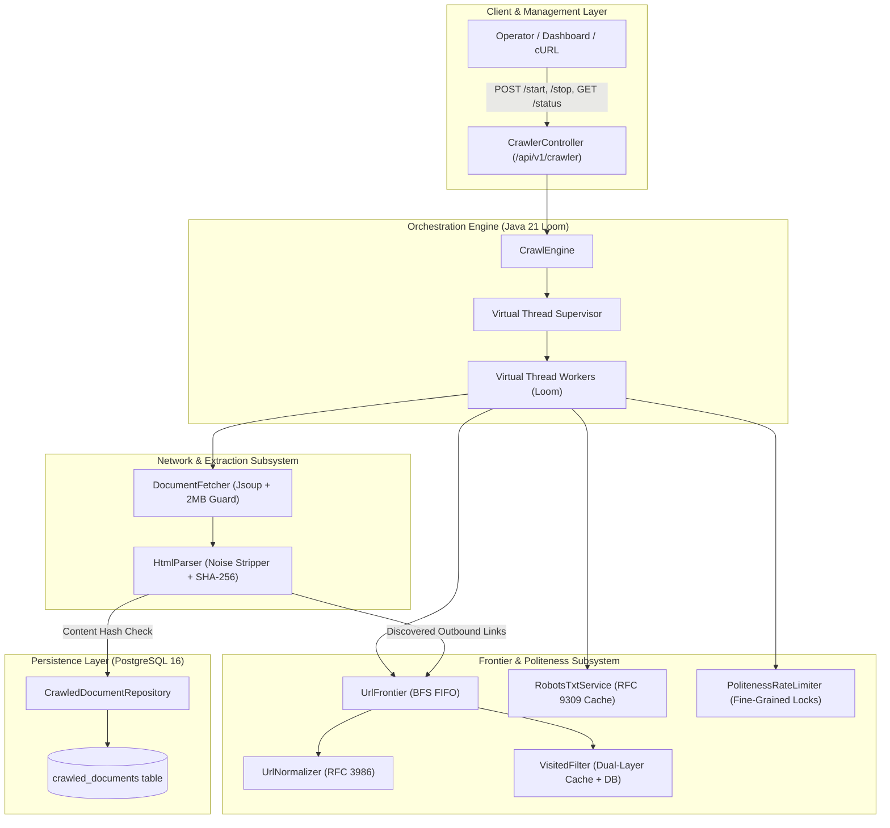

# SearchForge Phase 2: Web Crawler — Comprehensive Engineering Guide

This document is the master engineering reference for **Phase 2: Web Crawler** of the SearchForge project. It details the system architecture, design decisions, mathematical and algorithmic models, thread concurrency mechanics, database schema, REST API contracts, and verification audit.

---

## 1. Executive Summary & Objectives

The primary goal of Phase 2 is to build an industrial-grade, polite, and fault-tolerant **Web Crawler** from first principles using **Java 21 LTS**, **Spring Boot 4.1.2**, and **PostgreSQL 16**.

### Core Responsibilities:
1. **Frontier & Normalization:** Breadth-First Search (BFS) FIFO queue traversal, RFC 3986 URL canonicalization, relative-to-absolute resolution, and cycle prevention.
2. **Politeness & RFC 9309 Compliance:** Parse `robots.txt` rules using RFC 9309 longest-match evaluation with 24-hour caching, bot-specific user-agent matching, and per-domain thread-safe politeness rate limiting.
3. **Robust HTTP Retrieval & Parsing:** Non-crashing HTTP fetcher guarding against binary files (2MB limit, `text/html` validation), connection/read timeouts, DOM noise stripping (`script`, `style`, `nav`, `footer`), metadata extraction, and relative link discovery.
4. **Content-Hash Deduplication:** SHA-256 fingerprinting to eliminate duplicate content storage across mirror URLs.
5. **Project Loom Concurrency:** Non-blocking multi-worker crawling powered by Java 21 Virtual Threads and thread-safe starvation prevention.
6. **Telemetry & Administrative REST API:** Asynchronous execution (`202 Accepted`), conflict management (`409 Conflict`), graceful shutdown signals, and paginated document inspection via Spring Data JPA `Pageable`.

---

## 2. End-to-End System Architecture



---

## 3. Subsystem Breakdown & Implementation

### 3.1. Configuration Subsystem (`com.searchforge.crawler.config`)
* **`CrawlerProperties`**: Immutable Java 21 Record bound to the `crawler.*` prefix via `@ConfigurationProperties`.
* **Configured Properties**:
  * `user-agent`: Defaults to `"SearchForgeBot/1.0"`.
  * `seed-urls`: Initial entry points for BFS traversal.
  * `allowed-domains`: Domain whitelist guard.
  * `max-depth`: Maximum BFS hops from seeds (default `2`).
  * `max-pages`: Maximum pages to crawl per run (default `100`).
  * `crawl-delay-ms`: Fallback politeness delay (default `1000ms`).
  * `connect-timeout-ms` / `read-timeout-ms`: Socket guardrails (default `3000ms` / `5000ms`).
  * `concurrency`: Number of concurrent virtual worker threads (default `4`).

### 3.2. Persistence Subsystem (`com.searchforge.crawler.model`, `repository`)
* **`CrawledDocument` Entity**:
  * `@Table(name = "crawled_documents")` with indexes on `domain` and `content_hash`.
  * `url`: `VARCHAR(2048) UNIQUE NOT NULL`.
  * `clean_text`: `TEXT` containing stripped, searchable plain body content.
  * `content_hash`: `VARCHAR(64) NOT NULL` (SHA-256 hex digest).
  * `http_status_code`: `INT NOT NULL`.
  * `crawled_at`: `TIMESTAMP WITH TIME ZONE NOT NULL`.
* **`CrawledDocumentRepository`**:
  * Inherits Spring Data `JpaRepository<CrawledDocument, Long>` and `PagingAndSortingRepository`.
  * Methods: `existsByUrl`, `existsByContentHash`, `findByUrl`, `countByDomain`, `findByDomain`.

### 3.3. URL Frontier & Normalization (`com.searchforge.crawler.url`)
* **`UrlNormalizer`**:
  * Compliant with **RFC 3986**.
  * Lowercases scheme (`http`, `https`) and host (`EXAMPLE.COM` $\to$ `example.com`).
  * Strips URL fragments (`#section`).
  * Removes default ports (`:80` for HTTP, `:443` for HTTPS).
  * Normalizes path slashes (removes duplicate slashes and trailing slashes for root/subpaths).
  * Resolves relative paths (`/about`, `../contact`) against parent base URLs using `URI.resolve()`.
  * Discards non-HTTP protocols (`mailto:`, `javascript:`, `tel:`).
* **`VisitedFilter`**:
  * **Dual-Layer Deduplication**: In-memory `ConcurrentHashMap.newKeySet()` for $O(1)$ fast lookups during active runs + database lookup fallback (`repository.existsByUrl(url)`) across separate crawl sessions.
* **`UrlFrontier`**:
  * Strict FIFO Breadth-First Search queue backed by `ConcurrentLinkedQueue<CrawlTask>`.
  * Enforces `maxDepth` filtering and `allowedDomains` whitelisting before enqueuing.

### 3.4. Compliance & Politeness Subsystem (`com.searchforge.crawler.politeness`)
* **`RobotsTxtRules`**:
  * Implements **RFC 9309**: The longest matching path rule takes precedence over shorter rules.
  * In case of path length ties between `Allow` and `Disallow`, `Allow` takes precedence.
* **`RobotsTxtService`**:
  * Fetches `http(s)://domain/robots.txt` using `DocumentFetcher`.
  * In-memory cache backed by `ConcurrentHashMap<String, CachedRobots>` with a **24-hour Time-To-Live (TTL)**.
  * Prioritizes rules targeted at `SearchForgeBot` over generic `User-agent: *`.
  * Gracefully handles 404 (all allowed) and 5xx (conservative disallow).
* **`PolitenessRateLimiter`**:
  * Fine-grained per-domain locking: Each domain has its own lock object in `ConcurrentHashMap<String, Object>`.
  * Workers crawling different domains execute in parallel without blocking each other.
  * Workers hitting the same domain sleep until the configured `crawlDelayMs` has elapsed since the last request.

### 3.5. HTML Fetching & Parsing Subsystem (`com.searchforge.crawler.fetcher`, `parser`)
* **`DocumentFetcher`**:
  * Executes HTTP GET using Jsoup with explicit socket connect and read timeouts.
  * Validates `Content-Type` header: only processes `text/html` (drops PDF, ZIP, images).
  * Body size guard: Enforces a maximum response size of **2MB** (`maxBodySize(2 * 1024 * 1024)`) to prevent OutOfMemory (OOM) attacks from malicious or oversized web pages.
  * Error handling: Catches `HttpStatusException`, `SocketTimeoutException`, `IOException` gracefully, returning `Optional.empty()` without crashing the thread.
* **`HtmlParser`**:
  * DOM Sanitization: Strips non-content and noise tags: `script`, `style`, `noscript`, `iframe`, `nav`, `footer`, `header`, `aside`.
  * Title extraction: Parses `<title>`, falling back to the first `<h1>` if empty.
  * Link discovery: Extracts all `<a href>` links resolved to absolute URLs (`abs:href`).
  * Content Fingerprinting: Generates a 64-character hex SHA-256 hash of `cleanText` for deduplication.

### 3.6. Engine Orchestration & Java 21 Concurrency (`com.searchforge.crawler.engine`)
* **`CrawlEngine`**:
  * Coordinates the crawl loop across `Frontier`, `Robots`, `RateLimiter`, `Fetcher`, `Parser`, and `Repository`.
  * Thread-safe atomic lifecycle state machine: `AtomicReference<CrawlState>` (`IDLE`, `RUNNING`, `STOPPING`, `STOPPED`, `COMPLETED`).
  * **Asynchronous Supervisor**: `startAsync(seedUrls)` dispatches a dedicated Java 21 Virtual Thread returning a `CompletableFuture<CrawlStatus>`.
  * **Virtual Worker Pool**: Spawns $N$ workers using `Executors.newVirtualThreadPerTaskExecutor()`.
  * **Starvation & Early Exit Prevention**:
    * Tracks `AtomicInteger activeWorkers`.
    * When a worker finds the frontier empty, it only terminates if `activeWorkers.get() == 0 && frontier.isEmpty()`.
    * If active workers are still processing tasks, the worker sleeps for 50ms, yielding its virtual thread back to the carrier thread pool.
  * **TOCTOU Deduplication Guard**:
    * Maintains `visitedContentHashes = ConcurrentHashMap.newKeySet()` so concurrent workers encountering mirror pages never perform duplicate inserts.

### 3.7. REST API & Monitoring Subsystem (`com.searchforge.crawler.controller`)
* **`CrawlerController` (`/api/v1/crawler`)**:
  * `POST /start`: Validates status, dispatches async crawl, returns `202 Accepted` (or `409 Conflict` if already running).
  * `POST /stop`: Graceful shutdown signal, returns `200 OK`.
  * `POST /reset`: Resets state, frontier, and caches, returns `200 OK`.
  * `GET /status`: Returns operational telemetry snapshot (`200 OK`).
  * `GET /documents`: Paginated list of crawled documents via Spring Data `Pageable` (`200 OK`).

---

## 4. PostgreSQL Database Schema

```sql
CREATE TABLE crawled_documents (
    id BIGSERIAL PRIMARY KEY,
    url VARCHAR(2048) NOT NULL UNIQUE,
    domain VARCHAR(255) NOT NULL,
    title VARCHAR(512),
    clean_text TEXT,
    content_hash VARCHAR(64) NOT NULL,
    http_status_code INT NOT NULL,
    crawled_at TIMESTAMP WITH TIME ZONE NOT NULL
);

-- Fast domain-based filtering and statistics
CREATE INDEX idx_crawled_docs_domain ON crawled_documents (domain);

-- Fast duplicate content detection across separate crawl runs
CREATE INDEX idx_crawled_docs_content_hash ON crawled_documents (content_hash);
```

---

## 5. REST API Specification & cURL Runbook

### 5.1. Start Asynchronous Crawl
```bash
curl -X POST http://localhost:8080/api/v1/crawler/start \
  -H "Content-Type: application/json" \
  -d '{
    "seedUrls": ["https://en.wikipedia.org/wiki/Computer_science"]
  }'
```
**Response (HTTP 202 Accepted):**
```json
{
  "state": "RUNNING",
  "isRunning": true,
  "pagesCrawled": 0,
  "pagesFailed": 0,
  "frontierQueueSize": 1,
  "startedAt": "2026-11-18T23:00:00Z",
  "elapsedSeconds": 0
}
```

### 5.2. Poll Telemetry Status
```bash
curl -X GET http://localhost:8080/api/v1/crawler/status
```
**Response (HTTP 200 OK):**
```json
{
  "state": "RUNNING",
  "isRunning": true,
  "pagesCrawled": 24,
  "pagesFailed": 1,
  "frontierQueueSize": 76,
  "startedAt": "2026-11-18T23:00:00Z",
  "elapsedSeconds": 14
}
```

### 5.3. Gracefully Stop Running Crawl
```bash
curl -X POST http://localhost:8080/api/v1/crawler/stop
```
**Response (HTTP 200 OK):**
```json
{
  "state": "STOPPING",
  "isRunning": false,
  "pagesCrawled": 25,
  "pagesFailed": 1,
  "frontierQueueSize": 75,
  "startedAt": "2026-11-18T23:00:00Z",
  "elapsedSeconds": 15
}
```

### 5.4. Query Paginated Crawled Documents
```bash
curl -X GET "http://localhost:8080/api/v1/crawler/documents?page=0&size=2&sort=crawledAt,desc"
```
**Response (HTTP 200 OK):**
```json
{
  "content": [
    {
      "id": 1,
      "url": "https://en.wikipedia.org/wiki/Computer_science",
      "domain": "en.wikipedia.org",
      "title": "Computer science - Wikipedia",
      "contentSnippet": "Computer science is the study of computation, information, and automation. Computer science spans theoretical disciplines such as algorithms, theory of computation, and information theory...",
      "contentHash": "5e884898da28047151d0e56f8dc6292773603d0d6aabbdd62a11ef721d1542d8",
      "httpStatusCode": 200,
      "crawledAt": "2026-11-18T23:00:02Z"
    }
  ],
  "pageable": {
    "pageNumber": 0,
    "pageSize": 2
  },
  "totalElements": 25,
  "totalPages": 13,
  "last": false
}
```

---

## 6. Phase 2 Acceptance Criteria Audit Checklist

| # | Acceptance Requirement | Status | Verification Evidence / Implementation |
| :---: | :--- | :---: | :--- |
| **1** | Type-safe configuration via Record | ✅ PASS | `CrawlerProperties.java` (@ConfigurationProperties) |
| **2** | YAML configuration binding | ✅ PASS | Verified in `CrawlerPropertiesTest` |
| **3** | JPA Entity for crawled documents | ✅ PASS | `CrawledDocument.java` with domain & hash indexes |
| **4** | PostgreSQL & in-memory test isolation | ✅ PASS | H2 in test scope, Docker PostgreSQL in prod |
| **5** | Repository queries & deduplication | ✅ PASS | `existsByUrl`, `existsByContentHash` tested in `CrawledDocumentRepositoryTest` |
| **6** | RFC 3986 URL canonicalization | ✅ PASS | `UrlNormalizer.java` lowercases, strips fragments & ports |
| **7** | Relative link resolution | ✅ PASS | `URI.resolve()` handles `/path`, `../` correctly |
| **8** | Visited URL deduplication | ✅ PASS | Dual-layer cache in `VisitedFilter.java` |
| **9** | BFS URL Frontier | ✅ PASS | FIFO Queue in `UrlFrontier.java` enforcing max-depth |
| **10**| Domain whitelisting | ✅ PASS | Non-whitelisted domains dropped at frontier enqueue |
| **11**| RFC 9309 robots.txt compliance | ✅ PASS | `RobotsTxtRules.java` longest-match evaluation |
| **12**| User-Agent specific robot rules | ✅ PASS | Prioritizes `SearchForgeBot` over `*` |
| **13**| Robots.txt caching (24-hour TTL) | ✅ PASS | In-memory cache in `RobotsTxtService.java` |
| **14**| Per-domain politeness rate limiting | ✅ PASS | Per-domain locks in `PolitenessRateLimiter.java` |
| **15**| Non-crashing HTTP document fetcher | ✅ PASS | `DocumentFetcher.java` with Jsoup & timeouts |
| **16**| Binary file & body size guards | ✅ PASS | Validates `text/html` and limits body to 2MB |
| **17**| DOM noise tag stripping | ✅ PASS | `HtmlParser.java` removes script, style, nav, footer |
| **18**| Clean text & outbound link extraction | ✅ PASS | Verified in `HtmlParserTest.java` |
| **19**| SHA-256 content deduplication | ✅ PASS | Fingerprint hashing prevents duplicate page persistence |
| **20**| Sequential CrawlEngine orchestration | ✅ PASS | `CrawlEngineTest.java` verifies end-to-end BFS |
| **21**| Java 21 Virtual Threads concurrency | ✅ PASS | Loom workers in `ConcurrentCrawlEngineTest.java` |
| **22**| Thread-safe starvation prevention | ✅ PASS | `activeWorkers` atomic counter prevents early exit |
| **23**| Asynchronous REST API (202 Accepted) | ✅ PASS | `CrawlerController.java` (`POST /start`) |
| **24**| Paginated document inspection | ✅ PASS | `GET /documents` tested in `CrawlerControllerTest` |

---

## 7. Complete Test Suite Matrix (55 Tests)

All 55 automated tests run hermetically offline using in-memory H2 and WireMock servers with zero external network dependencies:

* `CrawlerPropertiesTest` (2 tests): Configuration binding and default fallback enforcement.
* `UrlNormalizerTest` (6 tests): RFC 3986 normalization, port stripping, relative resolution.
* `VisitedFilterTest` (4 tests): Dual-layer in-memory and database deduplication.
* `UrlFrontierTest` (5 tests): FIFO BFS ordering, depth limits, and domain whitelisting.
* `RobotsTxtServiceTest` (4 tests): RFC 9309 longest-match evaluation, 24h caching, 404/5xx handling.
* `PolitenessRateLimiterTest` (3 tests): Per-domain locking and rate delay intervals.
* `DocumentFetcherTest` (5 tests): HTML validation, 2MB size cap, timeout resilience.
* `HtmlParserTest` (5 tests): DOM noise stripping, title fallbacks, SHA-256 fingerprinting.
* `CrawledDocumentRepositoryTest` (4 tests): JPA persistence, duplicate hashing, domain queries.
* `CrawlEngineTest` (3 tests): End-to-end sequential BFS, cycle handling, deduplication.
* `ConcurrentCrawlEngineTest` (2 tests): Java 21 Virtual Threads concurrent crawling and graceful stop.
* `CrawlerControllerTest` (6 tests): MockMvc slice tests (202, 409, 200, pagination).
* `HealthControllerTest` (2 tests): Phase 1 health endpoints.
* `HealthServiceTest` (3 tests): Phase 1 JDBC socket probing and error masking.
* `SearchForgeApplicationTests` (1 test): Spring Boot ApplicationContext bootstrapper.

**Total: 55 Tests, 0 Failures, 0 Errors, 0 Skipped.**
