# SearchForge Phase 3: Inverted Index & Tokenization Engine — Comprehensive Engineering Guide

This document is the master engineering reference for **Phase 3: Inverted Index & Tokenization Engine** of the SearchForge project. It details the complete text processing pipeline, the Porter Stemming algorithm, the thread-safe in-memory inverted index, exact phrase and proximity search, persistent relational indexing, corpus synchronization, the Boolean retrieval engine with recursive-descent query parsing, and the administrative/search REST API.

---

## 1. Executive Summary & Objectives

The primary goal of Phase 3 is to construct an industrial-strength, memory-efficient, and academically rigorous **Inverted Index and Boolean Retrieval Engine** from first principles using **Java 21 LTS**, **Spring Boot 4.1.2**, and **PostgreSQL 16**.

### Core Responsibilities:
1. **Linguistic Text Processing Pipeline:** Unicode NFD decomposition, diacritic stripping, case-folding, possessive suffix removal, punctuation stripping, and stop-word filtering across 130+ English stop words with precise sequential position tracking.
2. **Porter Stemming Algorithm (1980):** Full 5-step cascade implementation adhering to Martin Porter's seminal specifications, evaluating syllable measure $m$, vowel containment $*v*$, double consonants $*d$, and consonant-vowel-consonant patterns $*o$.
3. **Core Inverted Index Models:** Thread-safe `Posting` records, `PostingsList` containers maintained in strictly ascending order by `documentId` via binary search insertion, and `InMemoryInvertedIndex` utilizing `ConcurrentHashMap` for sub-millisecond dictionary lookups and corpus metrics ($N$, $\text{avgdl}$, $|d|$).
4. **Positional Indexing & Exact Phrase Search:** Exact phrase evaluation through linear positional intersection ($O(P_1 + P_2)$) and proximity window searching ($k$-word distance) using a two-pointer sliding window.
5. **Persistent Relational Indexing:** Schema design with `indexed_terms`, `term_postings` (compound unique constraint on `(term_id, document_id)`), and `indexed_document_metadata` supporting zero-dependency portable comma-separated position encoding.
6. **Corpus Synchronization & Ingestion:** `IndexingEngine` reading unindexed crawled web documents, parsing and tokenizing text, executing atomic database persistence, synchronizing the in-memory index, and supporting cold startup index warmups from database storage.
7. **Boolean Retrieval Engine & Recursive-Descent Query Parser:** Lexical analyzer and operator-precedence parser producing an Abstract Syntax Tree (AST) supporting explicit and implicit `AND`, `OR`, `NOT`, exact phrases, nested parentheses, and two-pointer linear merge algorithms ($O(L_1 + L_2)$).
8. **Administrative REST API & Telemetry:** Endpoints for `/api/v1/index/build`, `/api/v1/index/rebuild`, `/api/v1/index/warmup`, `/api/v1/index/stats`, and `/api/v1/search/boolean`.

---

## 2. End-to-End System Architecture

```mermaid
flowchart TD
    subgraph ClientSubsystem["Client & Consumer Layer"]
        Consumer["User / Browser / Dashboard / cURL"]
        Controller["IndexController (/api/v1)"]
    end

    subgraph RetrievalSubsystem["Boolean Retrieval & Parsing Subsystem"]
        Lexer["BooleanQueryLexer (Tokens)"]
        Parser["BooleanQueryParser (AST)"]
        Engine["BooleanRetrievalEngine"]
        Merger["PostingsMerger (Two-Pointer O(L1+L2))"]
        Positional["PositionalIndexSearcher (Phrase & Proximity)"]
    end

    subgraph TextAnalysisSubsystem["Linguistic Analysis Subsystem"]
        Normalizer["TextNormalizer (Unicode NFD & Diacritics)"]
        StopFilter["StopWordFilter (O(1) Immutable HashSet)"]
        Stemmer["PorterStemmer (5-Step Morphological Cascade)"]
        Tokenizer["Tokenizer (Word Boundaries & Positions)"]
    end

    subgraph MemoryIndexSubsystem["High-Performance RAM Subsystem"]
        InMemIndex["InMemoryInvertedIndex (ConcurrentHashMap)"]
        PostingsContainer["PostingsList (Binary Search Ascending Docs)"]
    end

    subgraph PersistentSubsystem["Persistence & Synchronization Subsystem"]
        IndexingEng["DefaultIndexingEngine (Orchestrator)"]
        TermRepo["IndexedTermRepository (indexed_terms)"]
        PostingRepo["TermPostingRepository (term_postings)"]
        MetaRepo["IndexedDocumentMetadataRepository"]
        CrawlRepo["CrawledDocumentRepository (crawled_documents)"]
        PostgresDB[("PostgreSQL 16 Storage")]
    end

    Consumer -->|GET /api/v1/search/boolean?q=...| Controller
    Consumer -->|POST /build, /rebuild, /warmup, GET /stats| Controller
    Controller --> Engine
    Controller --> IndexingEng

    Engine --> Lexer
    Lexer --> Parser
    Parser --> Engine
    Engine --> Merger
    Engine --> Positional
    Engine --> InMemIndex

    IndexingEng --> CrawlRepo
    IndexingEng --> Tokenizer
    Tokenizer --> Normalizer
    Tokenizer --> StopFilter
    Tokenizer --> Stemmer

    IndexingEng --> InMemIndex
    IndexingEng --> TermRepo
    IndexingEng --> PostingRepo
    IndexingEng --> MetaRepo

    TermRepo --> PostgresDB
    PostingRepo --> PostgresDB
    MetaRepo --> PostgresDB
    CrawlRepo --> PostgresDB
```



---

## 3. Subsystem Breakdown & Implementation

### 3.1. Text Processing & Tokenization (`com.searchforge.indexer.token`)
* **`ProcessedToken`**:
  * Immutable record: `record ProcessedToken(String term, int position)`.
  * Preserves word token offsets within the original document.
* **`TextNormalizer`**:
  * Unicode NFD canonical decomposition (`java.text.Normalizer.Form.NFD`).
  * Strips diacritical combining marks via regex pattern `\\p{M}+`.
  * Case-folds all text to lowercase and strips English possessive markers (`'s`, `’s`).
  * Replaces all non-alphanumeric characters with standard whitespace.
* **`StopWordFilter`**:
  * Thread-safe $O(1)$ lookup backed by an unmodifiable `Set<String>` containing 130+ high-frequency English functional words (e.g., `the`, `is`, `which`, `with`, `for`, `at`).
* **`Tokenizer`**:
  * Splices raw text on word boundaries (`\\s+`).
  * Normalizes tokens, applies the Porter Stemmer, and filters stop words.
  * **Critical Positional Invariant:** Position counter increments for every encountered word (including stop words) so that gaps are maintained and phrase search does not create false positive matches across dropped words.
  * Provides dual entry points: `tokenize(text)` (stemmed) and `tokenizeUnstemmed(text)`.

### 3.2. Porter Stemming Algorithm (`com.searchforge.indexer.stem`)
* **`Stemmer`**: Standard functional interface `String stem(String word)`.
* **`PorterStemmer`**: Complete implementation of Martin Porter's 1980 algorithm.
  * **State Isolation:** Encapsulates per-invocation string manipulation within an inner `State` helper class, making `PorterStemmer` completely stateless and thread-safe.
  * **Consonant/Vowel Definitions:**
    * Consonant $c$: Any letter other than `a, e, i, o, u`, plus `y` preceded by a vowel.
    * Vowel $v$: Any letter that is not a consonant.
  * **Syllable Measure ($m$):** Counts sequences of $[C](VC)^m[V]$.
  * **Condition Checks:**
    * `*v*`: Stem contains at least one vowel.
    * `*d`: Stem ends with a double consonant (e.g., `-tt`, `-ss`).
    * `*o`: Stem ends with consonant-vowel-consonant ($cvc$) where the final consonant is not `w`, `x`, or `y`.
  * **5-Step Reduction Cascade:**
    * *Step 1a & 1b:* Plural suffixes (`-sses` $\rightarrow$ `-ss`, `-ies` $\rightarrow$ `-i`, `-s` $\rightarrow$ `""`) and past participles (`-eed`, `-ed`, `-ing`).
    * *Step 1c:* Terminal `-y` replacement (`happy` $\rightarrow$ `happi`).
    * *Step 2:* Derivational suffix conversion (`-ational` $\rightarrow$ `-ate`, `-ization` $\rightarrow$ `-ize`, `-biliti` $\rightarrow$ `-ble`).
    * *Step 3:* Complex suffix reduction (`-iciti` $\rightarrow$ `-ic`, `-ful` $\rightarrow$ `""`, `-ness` $\rightarrow$ `""`).
    * *Step 4:* Residual suffix stripping (`-al`, `-ance`, `-er`, `-ic`, `-able`, `-ive`, `-ize`) when $m > 1$.
    * *Step 5a & 5b:* Terminal `-e` and double consonant cleanup (`probate` $\rightarrow$ `probat`, `controll` $\rightarrow$ `control`).

### 3.3. Inverted Index Core Models (`com.searchforge.indexer.model`, `index`)
* **`Posting`**:
  * Record: `record Posting(long documentId, int termFrequency, List<Integer> positions) implements Comparable<Posting>`.
  * Implements `Comparable` based strictly on `documentId` ascending, enabling $O(\log K)$ binary search and $O(L_1 + L_2)$ linear merges.
* **`PostingsList`**:
  * Thread-safe synchronized container of `Posting` entries.
  * Inserts or merges postings via `Collections.binarySearch`.
  * Tracks document frequency ($df_t = \text{size()}$) and corpus term frequency ($ctf_t = \sum tf$).
  * Supports document posting removal (`removePosting(long documentId)`).
* **`InMemoryInvertedIndex`**:
  * Implementation of `InvertedIndex` interface backed by `ConcurrentHashMap<String, PostingsList>` for dictionary terms and `ConcurrentHashMap<Long, Integer>` for document lengths.
  * Exposes instantaneous corpus-wide statistics: total documents ($N$), vocabulary size ($V$), and average document length ($\text{avgdl} = \frac{\sum |d|}{N}$).
  * Supports fast bulk re-population (`addDocumentPostings`) without re-running tokenization.

### 3.4. Positional Indexing & Exact Phrase Search (`com.searchforge.indexer.search`)
* **`PhraseMatch`**: Record capturing `(long documentId, int matchCount, List<Integer> startPositions)`.
* **`PositionalIndexSearcher`**:
  * **Exact Phrase Intersection:** For phrase tokens $t_1, t_2, \dots, t_k$, intersects postings lists. Within each common document, evaluates positional offsets such that $pos(t_{i+1}) - pos(t_i) == 1$.
  * **Proximity Window Search:** Two-pointer linear scan checking whether two terms co-occur within a window of $k$ tokens ($|pos_1 - pos_2| \le k$).
  * Returns sorted results ordered by match count descending and `documentId` ascending.

### 3.5. Persistence Layer (`com.searchforge.indexer.entity`, `repository`)
* **`IndexedTerm` (`indexed_terms`)**:
  * Columns: `id` (BIGSERIAL PK), `term` (VARCHAR 128 UNIQUE), `document_frequency` (INT), `total_term_frequency` (BIGINT).
  * Unique index: `idx_indexed_terms_term`.
* **`TermPosting` (`term_postings`)**:
  * Columns: `id` (BIGSERIAL PK), `term_id` (FK to `indexed_terms`), `document_id` (BIGINT), `term_frequency` (INT), `positions` (VARCHAR 2048).
  * Constraints: Compound unique constraint `uk_term_postings_term_doc` on `(term_id, document_id)`.
  * Indexes: `idx_term_postings_term_id` and `idx_term_postings_doc_id`.
  * Portability: Encodes positions as comma-separated integers (`"0,7,24"`) with entity helper methods `getPositionsList()` and `setPositionsList(...)`.
* **`IndexedDocumentMetadata` (`indexed_document_metadata`)**:
  * Columns: `document_id` (BIGINT PK), `token_count` (INT), `indexed_at` (TIMESTAMP WITH TIME ZONE).
* **Spring Data Repositories**:
  * `IndexedTermRepository`: `findByTerm`, `existsByTerm`.
  * `TermPostingRepository`: `findByTermId`, `findByDocumentId`, `deleteByDocumentId`.
  * `IndexedDocumentMetadataRepository`: `findAverageDocumentLength`, `findTotalTokenCount`.

### 3.6. Indexing Engine & Corpus Synchronization (`com.searchforge.indexer.service`)
* **`DefaultIndexingEngine`**:
  * Coordinates linguistic processing, database persistence, and memory synchronization.
  * **Idempotency & Re-indexing:** Automatically detects if a document was previously indexed, safely purges child postings first (`postingRepository.deleteAll(postings); postingRepository.flush();`), updates/deletes obsolete terms, and inserts fresh postings.
  * **Corpus Batch Synchronization (`synchronizeCorpus`):** Queries unindexed documents from `crawled_documents` using `PageRequest.of(0, batchSize)` until the backlog is empty.
  * **Cold Startup Warmup (`warmupInMemoryIndex`):** Reads all persisted terms and postings into `InMemoryInvertedIndex` on server startup without re-tokenizing text.

### 3.7. Boolean Retrieval Engine & Query Parser (`com.searchforge.indexer.retrieval`)
* **Query AST Hierarchy (`com.searchforge.indexer.retrieval.ast`)**:
  * Sealed `QueryNode` implemented by `TermNode`, `PhraseNode`, `AndNode`, `OrNode`, and `NotNode`.
* **`BooleanQueryLexer`**:
  * Tokenizes input into `TERM`, `PHRASE`, `AND`, `OR`, `NOT`, `LPAREN`, and `RPAREN`.
* **`BooleanQueryParser`**:
  * Recursive-descent parser enforcing operator precedence:
    $$\text{Parentheses} > \text{Unary NOT} > \text{Binary AND / Implicit AND} > \text{Binary OR}$$
  * Automatically binds adjacent terms with implicit `AND` (e.g., `java spring` $\rightarrow$ `java AND spring`).
  * Converts infix `A NOT B` into `NotNode(A, B)`.
* **`PostingsMerger`**:
  * Pure two-pointer linear merge algorithms executing in $O(L_1 + L_2)$ time:
    * `intersect(p1, p2)`: Intersection ($L_1 \cap L_2$).
    * `union(p1, p2)`: Union ($L_1 \cup L_2$).
    * `difference(p1, p2)`: Difference ($L_1 \setminus L_2$).
    * `intersectAll(lists)`: Optimizes multi-term `AND` queries by sorting lists by size ascending ($\min(df_t)$) before intersecting.
* **`DefaultBooleanRetrievalEngine`**:
  * Evaluates query AST against `InvertedIndex` (for single terms), `PositionalIndexSearcher` (for phrases), and `PostingsMerger`.
  * Pure negations (`NOT python`) evaluate against the document universe $U = \text{invertedIndex.getAllDocumentIds()}$.

### 3.8. REST API & Telemetry (`com.searchforge.indexer.controller`)
* **`IndexController`**: Exposes administrative indexing management and Boolean search operations via HTTP.

---

## 4. REST API Reference

### 4.1. Trigger Corpus Synchronization
* **Endpoint:** `POST /api/v1/index/build`
* **Query Parameters:** `batchSize` (optional, default `100`).
* **Response:** `200 OK`
```json
{
  "documentsProcessed": 50,
  "documentsIndexed": 50,
  "documentsSkipped": 0,
  "totalTokensIndexed": 12450,
  "durationMs": 312
}
```

### 4.2. Rebuild Inverted Index
* **Endpoint:** `POST /api/v1/index/rebuild`
* **Description:** Drops existing inverted index tables, purges in-memory index, and indexes all documents from `crawled_documents`.
* **Response:** `200 OK`
```json
{
  "documentsProcessed": 100,
  "documentsIndexed": 100,
  "documentsSkipped": 0,
  "totalTokensIndexed": 24800,
  "durationMs": 620
}
```

### 4.3. Warm Up In-Memory Index
* **Endpoint:** `POST /api/v1/index/warmup`
* **Description:** Loads persisted postings and metadata from PostgreSQL into RAM.
* **Response:** `200 OK`
```json
{
  "status": "SUCCESS",
  "message": "In-memory inverted index successfully warmed up from persistent storage"
}
```

### 4.4. Index Telemetry & Statistics
* **Endpoint:** `GET /api/v1/index/stats`
* **Response:** `200 OK`
```json
{
  "totalIndexedDocuments": 100,
  "vocabularySize": 3420,
  "totalPostings": 18240,
  "averageDocumentLength": 124.5,
  "inMemoryDocuments": 100,
  "inMemoryVocabularySize": 3420
}
```

### 4.5. Boolean Search Retrieval
* **Endpoint:** `GET /api/v1/search/boolean?q={query}&limit={limit}`
* **Query Parameters:**
  * `q` (required): Boolean query string (e.g. `(java OR python) AND "spring boot" NOT legacy`).
  * `limit` (optional, default `20`): Maximum results to return.
* **Response:** `200 OK`
```json
{
  "query": "(java OR python) AND \"spring boot\" NOT legacy",
  "totalHits": 1,
  "durationMs": 4,
  "hits": [
    {
      "documentId": 42,
      "url": "https://searchforge.dev/guide",
      "domain": "searchforge.dev",
      "title": "Spring Boot Search Engine",
      "snippet": "Comprehensive architectural guide to building custom search engines in Spring Boot with inverted indices and Boolean retrieval..."
    }
  ]
}
```
* **Error Response:** `400 Bad Request` if `q` is missing or empty.

---

## 5. Algorithmic Complexity & Performance Analysis

| Operation | Algorithm | Time Complexity | Auxiliary Space | Notes |
| :--- | :--- | :--- | :--- | :--- |
| **Tokenization & Normalization** | Unicode NFD + Word Split | $O(N_{\text{chars}})$ | $O(N_{\text{tokens}})$ | Linear single-pass decomposition |
| **Porter Stemming** | 5-Step Reduction Cascade | $O(L_{\text{word}})$ | $O(1)$ | Stateless per-invocation character buffer |
| **Dictionary Lookup** | `ConcurrentHashMap.get()` | $O(1)$ average | $O(1)$ | Lock-free concurrent read access |
| **Posting Insertion** | Binary Search Insertion | $O(\log K + K)$ | $O(1)$ | Maintains strictly sorted document order |
| **Phrase Search** | Positional Intersection | $O(P_1 + P_2)$ | $O(P_{\text{match}})$ | Linear merge on sorted position lists |
| **Proximity Search** | Two-Pointer Sliding Window | $O(P_1 + P_2)$ | $O(P_{\text{match}})$ | Constant window distance $|pos_1 - pos_2| \le k$ |
| **AND Intersection** | Two-Pointer Linear Merge | $O(L_1 + L_2)$ | $O(\min(L_1, L_2))$ | Pre-sorted list traversal without hashing |
| **Multi-Term AND** | Size-Ascending Greedy Merge | $O(\sum L_i)$ | $O(\min(L_i))$ | Intersects smallest postings lists first |
| **OR Union** | Two-Pointer Linear Union | $O(L_1 + L_2)$ | $O(L_1 + L_2)$ | Disjoint set combination with deduplication |
| **NOT Difference** | Two-Pointer Linear Difference| $O(L_1 + L_2)$ | $O(L_1)$ | Filters elements of $L_1$ absent from $L_2$ |
| **Pure Negation** | Difference with Universe $U$ | $O(|U| + L)$ | $O(|U|)$ | Evaluated against corpus document set |

---

## 6. Comprehensive Verification & Test Audit

Across all 8 tasks of Phase 3, **118 automated tests** were authored and verified. All tests run hermetically offline without requiring external network connections.

### Test Suite Summary:
* `TokenizerTest`: 9 tests verifying Unicode NFD normalization, diacritics removal, stop-word gaps, and stemming integration.
* `PorterStemmerTest`: 5 tests verifying 5-step cascades, plural/past reductions, vowel/measure conditions, and idempotency.
* `InMemoryInvertedIndexTest`: 6 tests verifying term frequencies, document counts, $\text{avgdl}$, vocabulary sizes, and 8-thread concurrency safety.
* `PositionalIndexSearcherTest`: 5 tests verifying exact multi-word phrase matching, non-consecutive position rejection, and sliding-window proximity searches.
* `IndexPersistenceTest`: 6 tests verifying JPA entity mapping, unique constraints on `term` and `(term_id, document_id)`, comma-separated positions encoding, and aggregate JPQL queries.
* `IndexingEngineTest`: 6 tests verifying single-document indexing, idempotent re-indexing, batch corpus synchronization, cold startup warmup from storage, and empty document handling.
* `BooleanQueryParserTest`: 11 tests verifying AST construction, operator precedence (`NOT` > `AND` > `OR`), parentheses overrides, implicit `AND`, and syntax error validation.
* `BooleanRetrievalEngineTest`: 9 tests verifying end-to-end `AND`, `OR`, `NOT`, exact phrases, nested expressions, and pure negations against the corpus universe.
* `IndexControllerTest`: 6 tests verifying REST API endpoints (`/api/v1/index/*` and `/api/v1/search/boolean`) using Spring MockMvc.
* **Prior Phase Tests (Preserved):** 55 crawler and health tests.

**Total Automated Tests:** **118 Passing** (Failures: 0, Errors: 0, Skipped: 0).

---

## 7. Conclusion & Next Steps

Phase 3 is 100% complete. SearchForge now features a fully operational, mathematically verified Inverted Index and Boolean Retrieval Engine capable of sub-millisecond querying over crawled web documents.

### Transition to Phase 4 (Scoring, Ranking & BM25 Engine):
In Phase 4, we will enhance SearchForge from exact Boolean matching to probabilistic relevance ranking:
- **Okapi BM25 Ranking Function:** Tuning $k_1$ (term frequency saturation) and $b$ (document length normalization).
- **Inverse Document Frequency (IDF):** Computing $\ln\left(1 + \frac{N - df + 0.5}{df + 0.5}\right)$.
- **Vector Space Model (VSM) & TF-IDF Cosine Similarity.**
- **Top-$K$ Query Evaluation:** Priority queue (Min-Heap) for retrieving top-10 ranked search results.
