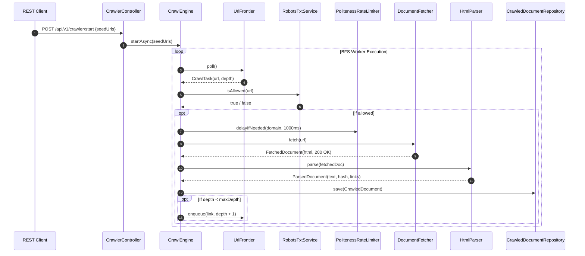
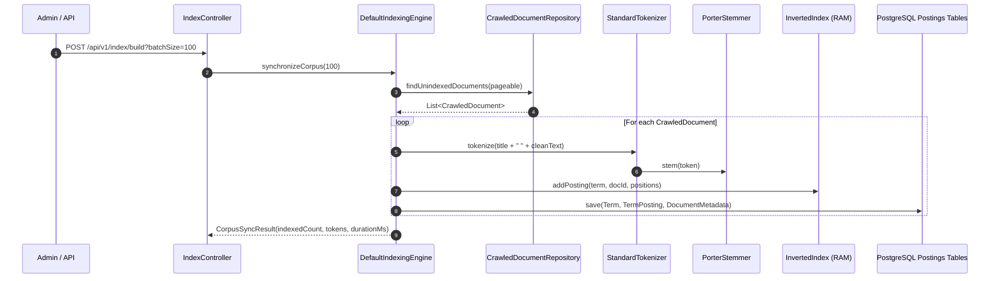
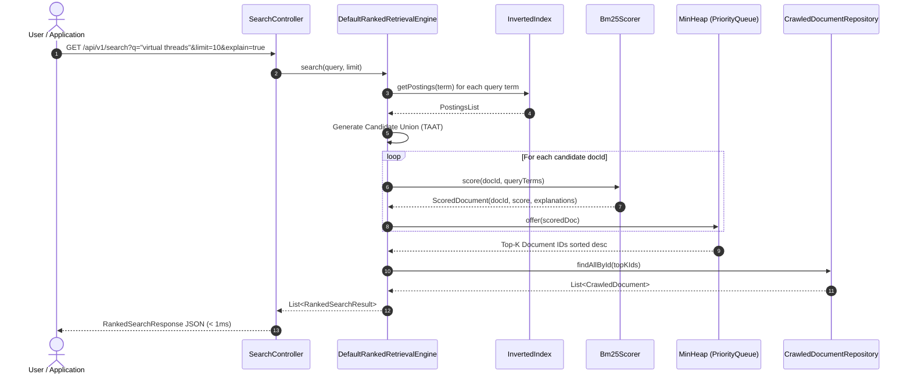

# SearchForge Data Flow & Invariants

This document details the lifecycle of data moving through SearchForge across its three primary modes: **Crawling**, **Indexing**, and **Ranked Query Execution**.

---

## 1. End-to-End Data Flow Lifecycles

### A. The Crawling Lifecycle

### B. The Indexing Lifecycle

### C. The Search Query Lifecycle

---

## 2. Core Architectural Invariants

1. **Zero-I/O Search Invariant:** No SQL database queries are executed during BM25 candidate scoring. Postings lists, document frequencies, and document lengths reside in RAM (`InvertedIndex`), guaranteeing sub-millisecond scoring execution.
2. **Positional Invariant:** Stop-words increment the token position counter even though they are omitted from the index dictionary. This preserves positional distance so that phrase searches like `"spring boot"` correctly verify adjacency ($\Delta pos = 1$).
3. **Monotonic IDF Invariant:** Robertson-Spärck Jones IDF is guaranteed strictly non-negative:
   $$\text{IDF}(t) = \ln\left(1 + \frac{N - n(t) + 0.5}{n(t) + 0.5}\right) \ge 0$$
   This eliminates the classic BM25 flaw where common words receive negative scores.
4. **Decoupled Crawl & Index Invariant:** Crawling writes exclusively to `crawled_documents`. Indexing executes asynchronously in chunked batches, isolating network I/O from indexing CPU spikes.
