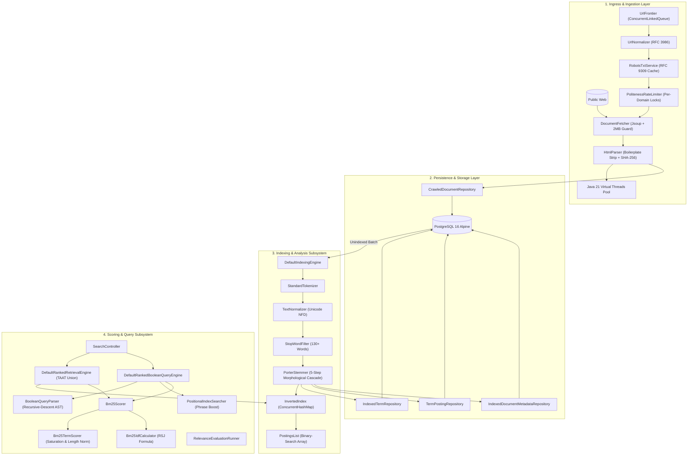

# SearchForge System Architecture

## 1. High-Level Architecture Overview

SearchForge is architected as an industrial-grade, decoupled search engine built entirely from first principles in **Java 21 LTS** and **Spring Boot**. 

The system implements zero external search engines (no Apache Lucene, Elasticsearch, or external cloud APIs). Every component—from low-level socket fetching to recursive-descent query AST evaluation and Okapi BM25 relevance scoring—is written from scratch.

---

## 2. Subsystem Deep Dive

### A. Web Crawler Subsystem (`com.searchforge.crawler`)
* **`CrawlEngine.java`:** The supervisor coordinator. Spawns Java 21 Virtual Threads (`Executors.newVirtualThreadPerTaskExecutor()`) to process candidate crawl tasks without OS thread starvation.
* **`UrlFrontier.java`:** Thread-safe, lock-free Breadth-First Search (BFS) queue. Enforces max-depth limits and domain allowlists.
* **`UrlNormalizer.java`:** Canonicalizes raw URLs per RFC 3986 (lowercasing host, sorting query params, stripping `#fragments`, removing tracking tags).
* **`RobotsTxtService.java`:** Evaluates robots exclusion rules per RFC 9309. Parses user-agent directives, `Allow`/`Disallow` rules, and caches parsed rules with a 24-hour TTL.
* **`PolitenessRateLimiter.java`:** Fine-grained synchronization locks mapped by domain (`ConcurrentHashMap<String, Object>`). Enforces a 1,000 ms delay between successive requests to the same host without blocking other domains.
* **`DocumentFetcher.java`:** Robust HTTP client using Jsoup with 2MB payload ceiling, connection timeouts, and strict content-type filters (HTML only).
* **`HtmlParser.java`:** Removes DOM noise (`<script>`, `<style>`, `<nav>`, `<footer>`), extracts absolute outbound links (`a[href]`), and computes a 64-character SHA-256 fingerprint for deduplication.

### B. Indexing Subsystem (`com.searchforge.indexer`)
* **`DefaultIndexingEngine.java`:** Orchestrates batch synchronization between raw crawled documents and searchable postings.
* **`StandardTokenizer.java`:** Token stream generator preserving exact word positions while filtering punctuation and whitespace.
* **`TextNormalizer.java`:** Decomposes accented Unicode characters (`Normalizer.Form.NFD`) and strips combining diacritical marks.
* **`StopWordFilter.java`:** $O(1)$ set lookup filtering 130+ grammatical noise words while strictly incrementing position counters to maintain exact phrase integrity.
* **`PorterStemmer.java`:** Stateless, thread-safe implementation of Martin Porter’s 1980 5-step morphological reduction cascade.
* **`InvertedIndex.java`:** Dual-tier index structure. High-speed RAM dictionary backed by `ConcurrentHashMap<String, PostingsList>`, synchronized with relational PostgreSQL tables (`indexed_terms`, `term_postings`, `indexed_document_metadata`).

### C. Scoring & Ranking Subsystem (`com.searchforge.ranking`)
* **`Bm25IdfCalculator.java`:** Implements strictly non-negative Robertson-Spärck Jones IDF:
  $$\text{IDF}(t) = \ln\left(1 + \frac{N - n(t) + 0.5}{n(t) + 0.5}\right)$$
* **`Bm25TermScorer.java`:** Calculates term saturation curves ($k_1=1.2$) and document length normalization ($b=0.75$).
* **`Bm25Scorer.java`:** Computes document-level scores with full term-by-term explainability maps.
* **`DefaultRankedRetrievalEngine.java`:** Executes Term-At-A-Time (TAAT) candidate generation and uses a bounded Min-Heap priority queue (`PriorityQueue<ScoredDocument>`) to select top-$K$ hits in $\mathcal{O}(C \log K)$ time.
* **`DefaultRankedBooleanQueryEngine.java`:** Combines recursive-descent AST Boolean logic with BM25 ranking and positional exact phrase boosting.
* **`RelevanceMetricsCalculator.java`:** Computes Precision@K, Recall@K, Mean Reciprocal Rank (MRR), and NDCG@K.

---

## 3. Data Storage & Schema Design

SearchForge uses a clean relational schema in PostgreSQL (or H2 in dev):
1. **`crawled_documents`:** Stores raw HTML-extracted text, title, domain, URL, HTTP status code, crawl timestamp, and SHA-256 `content_hash` with unique index.
2. **`indexed_terms`:** Vocabulary dictionary storing distinct stemmed terms, document frequency ($df$), and collection term frequency ($ctf$).
3. **`term_postings`:** Inverted postings with compound unique constraint `(term_id, document_id)`, storing within-document term frequency ($tf$) and comma-separated token position arrays.
4. **`indexed_document_metadata`:** Document length $|d|$ and indexing timestamps used for length normalization.
